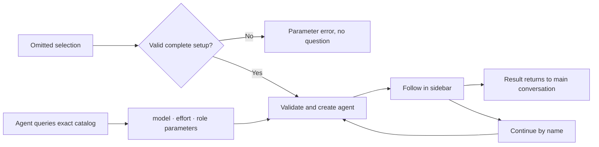

<div align="center">

# dsh-cliworker-now

[简体中文](README.md) | **English**

**A shared workspace for your AI CLIs inside DeepSeek Harness.**

Choose a CLI, model and role, dispatch a named agent, follow its work in the sidebar, and continue the same task.

[](https://github.com/SuperWheel/dsh-cliworker-now/releases/latest)
[](https://github.com/deepseek-ai/deepseek-harness)
[](#supported-clis)
[](LICENSE)

[Install](#install-and-update) · [Get started](#usage) · [FAQ](#faq) · [Report an issue](https://github.com/SuperWheel/dsh-cliworker-now/issues)

</div>

## What it is

dsh-cliworker-now is a **multi-CLI agent plugin for DeepSeek Harness**. It brings your terminal AI CLIs into Harness: the main conversation dispatches work and receives results, and the right sidebar shows each agent in Harness's own full conversation view, with its process, usage and status.

Each CLI keeps its own account, models and native sessions; the plugin organizes the work. It does not include any model service, subscription or API quota.

- **Development**: ask Codex to review code, then keep asking the same named agent.
- **Writing and editing**: set up separate roles for logic, style, commercial review and revision.
- **Long tasks**: each agent keeps its own conversation and records, so you can pick up where it stopped.

Once installed, the plugin appears in Harness as **CLI Worker / CLI Worker Now**.

## Features

- **One entry, many CLIs**: name a CLI in the main conversation and see every task grouped by CLI in the sidebar.
- **Native conversation experience**: child sessions use Harness's own conversation view, composer, model and permission controls, "+" menu and usage indicators, with queueing, stopping and follow-ups.
- **Native CLI behavior**: each CLI uses its own protocol, login and sessions. Models and reasoning effort come from that CLI's real catalog and current account.
- **Named agents with roles**: unique names, role presets and custom instructions, so you can call the same agent again.
- **Predictable scheduling**: nothing starts before you explicitly choose a model. One turn per session, serialized writes per directory, and no silent fallback to another CLI.
- **Goal, plan, feedback and fork**: use these Harness features in CLI child sessions; unsupported entries explain why.

## Screenshots

Captured from a real demo session in Harness Desktop (taken with v0.6.5; details may differ in the current version).


| Role presets | CLI connections and model preferences |
| --- | --- |
|  |  |

## Supported CLIs

| CLI | Native transport | CLI | Native transport |
| --- | --- | --- | --- |
| Antigravity | stream-json | OMP (Oh My Pi) | RPC |
| Codex | app-server | Pi | RPC |
| Claude Code | stream-json | Hermes Agent | Runs API |
| Kimi Code | ACP | OpenCode v1 / v2 | HTTP + SSE |
| Official MiMo Code | HTTP + SSE | Qoder CLI | ACP |
| ZCode | app-server | Qoder CN CLI | ACP |
| Grok Build | ACP | Cursor Agent (fork addition) | ACP |
| MiniMax Code (fork addition) | ACP | | |

AGY model-catalog probes have a separate bounded 60-second budget; the generic default for other CLIs remains 15 seconds, and task deadlines do not change. Internal deadline, caller cancellation and unconfirmed cleanup remain distinct. Settings, identity and the child process use the same selected default/lxy HOME. Existing account, exact-model, permission and post-queue checks remain intact; catalog success or Worker admission is not proof of generation. See the [preflight fix](openspec/changes/fix-agy-catalog-preflight/design.md) and [acceptance log](doc/tasks.md).

OpenCode v2 now has an **explicit read-only, text-only** path (`read_only`) through an existing trusted Linux service, including owned-session continuation and evidence-based stop. All native tools are denied: file tools, edits, shell, MCP, attachments, forks and live steering remain unavailable. Each owned session keeps its exact model and native variant; choose a new task to change models. Missing service is unavailable, not logout. The plugin does not start the service, read/copy its credential database or fall back to v1. Unknown admission or unconfirmed remote cleanup stays durably quarantined; bridge exit or a temporarily idle service is not a stop receipt. Account management is user-operated. Current acceptance covers actual Host/bridge and official DSH child integration with a **synthetic v2 service**, not a real OpenCode service/model, GUI or another platform. V1 support is retained.

Kimi 2.2 API status, model scopes and bindings share native credential resolution: inline keys, provider-type-specific private `env`, and explicitly declared `apiKeyEnv` references. Only the required explicit references cross the private child-environment boundary; missing references or conflicts never select a different key. API configuration is not OAuth login. Global `KIMI_MODEL_*` overlays and additional model protocols remain unsupported; real requests and the earlier GUI report still need separate acceptance.

Cursor Agent uses `cursor-agent acp` and preserves parameterized model IDs; this adapter currently exposes default effort only. On 2026-10-24 the parent verified read-only generation, same-session memory, native Read, stop and continuation after stop on the old online numeric-identity package. An extra task caused by a working-directory notice is tracked separately, not counted as a normal successful turn. New model controls, model/effort switching, tool bridge, attachments, writes/modes, GUI and Windows remain unverified. Account status comes from native `status --format json`, never DSH or another CLI's credentials.

A preparation-diagnostic source candidate reports fixed `resolve/spawn/read/exit/timeout` stages, closed reasons and confirmed exit codes. These are identity-metadata failures, not evidence of logout or quota exhaustion; a separate successful account/catalog query does not prove preparation succeeded. Nothing automatically retries, switches accounts or changes models. Cancellation and unconfirmed cleanup retain priority. Only synthetic acceptance is complete; the real cause and recovery still require deployment and an explicit check. See the [diagnostic design](openspec/changes/diagnose-cursor-preparation-metadata/design.md).

The current Cursor outcome projection increment is a source candidate: verified diagnostic text shapes (including indistinguishable legitimate quotes) produce uncertainty, not failure; ordinary error words and JSON do not. Only strictly associated current-run native tool evidence establishes failure. Reversible tool terminals wait for full-turn settlement; unknown tools remain UNKNOWN, queued followups pause, and nothing retries automatically. Current body, normal file content and diffs are retained. Unknown error presentations and read errors/ls timeouts discarded by the CLI cannot be reconstructed. Acceptance currently covers the [fixed-source contract and synthetic regressions](openspec/changes/fix-cursor-outcomes/source-contract.md), not deployment of this increment, real negative cases or GUI validation. A definite local permission refusal marks only its uniquely associated current-run tool FAILED at final settlement; later ID reuse instead remains unknown. Only read tools without verified native positive evidence become UNKNOWN/UNCERTAIN; normal raw text, including empty files, is retained. Missing output proves neither a successful read nor a specific underlying failure. This increment grants no permissions, adds no force flag and never retries automatically.

MiniMax Code is independent of MiMo; aliases are `mmx`, `mcode`, `minimax`, and `minimax code`, with stable entry `~/.minimax-code/bin/mcode`. Initial support is restricted to standard prod native token_plan OAuth. The data root is explicitly selected by `minimaxHome`, current `MINIMAX_DATA_DIR` / `MAVIS_DATA_DIR`, or `~/.minimax`; other account directories are never auto-selected. Authenticated ACP receipts determine opaque models and per-model efforts, and Ask permission must be confirmed before prompting. Plan, attachments, tool injection, forks and steer remain disabled. On 2026-10-24 the source was corrected to accept standard explicit managed baseURLs with the native `sk-xxx` placeholder, still subject to the existing OAuth identity checks. The placeholder never authorizes a task, and API/BYOK remains unsupported. The route and identity packages are live; a live receipt now isolates a native reasoning-policy rejection of an advertised configuration, not logout or proof that its whole model is unavailable. The user separately reports successful native M3.1-Flash generation with Effort max. This functional candidate isolates only that exact refusal, validates other configurations in clean sessions in the same process, and explicitly reports a verified subset. Exact current model/effort receipts avoid redundant setters; no parameters or user defaults are invented or changed. Unknown errors and the original time/source/cleanup gates still fail closed. Parent-side formal selection, generation/writes, continuation and stop acceptance after deployment remain pending. Synthetic tests do not prove real model, sidebar or Windows acceptance.

MiniMax configuration bindings use complete raw contents, not inode identity. Safe same-content atomic saves retain the binding; a bounded private operation version still rejects in-place touches and observed content changes. Credential, auth-state and identity-cache file stamps remain strict. Final snapshots cannot prove who wrote an atomic replacement or fully detect unobserved atomic A→B→A; this candidate makes no claim of complete file-event provenance, and real acceptance is still pending.

- **Platforms**: macOS / Windows. Install the native build of each CLI you use and complete that CLI's own login or API setup.
- **Host**: DeepSeek Harness (bundled resources currently target 0.2.1-rc.2); Node.js ≥ 22.19.0.
- **Verification**: tested versions and what has or has not been verified for each CLI are in [usage details](doc/usage-details.en.md#42-adapter-coverage-and-verification) and the [implementation log](doc/tasks.md). Listing models does not prove you can call them.

Installation, login and path notes for Qoder, Claude Code (including CC Switch), ZCode, Hermes and others are in [usage details](doc/usage-details.en.md).

## Install and update

End active tasks and quit Harness completely, then run:

```sh
dsh plugin --profile desktop add dsh-cliworker-now@latest
```

Reopen Harness afterwards. Enable the `dsh` command from the Desktop menu "Manage dsh command…". For a Web profile, replace `desktop` with `web`. You can also enter `dsh-cliworker-now@latest` under "Add plugin" on the Plugins page.

- Starting Harness does not update the plugin. pnpm 11 waits 24 hours after a release by default and may keep the previous version; check with `dsh plugin --profile desktop ls dsh-cliworker-now --depth=0`.
- Fallback package: `dsh plugin --profile desktop add https://github.com/SuperWheel/dsh-cliworker-now/releases/download/v0.8.2/dsh-cliworker-now-0.8.2.tgz`. Each release includes `SHA256SUMS.txt`.
- The package ships the interface extensions that native child conversations need; no host build is required, and uninstalling restores the official interface. If it conflicts with an existing interface override, the startup check refuses without changing your configuration. See [runtime-host](runtime-host/README.md).
- Uninstall with `dsh plugin --profile desktop remove dsh-cliworker-now`; local accounts, history and preferences are kept.

<details>
<summary>Install from GitHub source or develop locally</summary>

Requires Node.js ≥ 22.19 and pnpm 11.25.0 on `PATH`:

```sh
dsh plugin --profile desktop add github:SuperWheel/dsh-cliworker-now
```

Or build locally and link it (keep the source folder):

```sh
git clone https://github.com/SuperWheel/dsh-cliworker-now.git
cd dsh-cliworker-now
pnpm install --frozen-lockfile
pnpm --config.verifyDepsBeforeRun=false build
dsh plugin --profile desktop add .
```

For `ERR_PNPM_GIT_DEP_PREPARE_NOT_ALLOWED`, `ERR_PNPM_IGNORED_BUILDS` or pinning a commit, see [installation details](doc/usage-details.en.md#5-installation-and-updates).

</details>

## Usage

### 1. Dispatch

In a main conversation with a working folder selected, name the CLI explicitly:

> Use Codex to check this project's login error handling, and name the agent "Code Reviewer".

Short names work too: `agy` → Antigravity, `glm / zhipu` → ZCode, `harmes` → Hermes Agent. An ambiguous name returns candidates instead of dispatching.

The Agent supplies **model, effort and optional role** to `cliworker_start`; the plugin opens no selection, role or reuse question cards. Query exact choices with `cliworker_models({cli})` and preset IDs with `cliworker_roles()`. `role="none"` means no preset. Omitted fields reuse a valid complete setup from this parent, then this project/CLI; the first explicit model without a role uses no preset. Missing models or ambiguous efforts return `MODEL_REQUIRED` / `EFFORT_REQUIRED`, with no guessed selection, partial setup or Worker. Native login and permission approval gates remain unchanged.



To discover AGY choices after switching accounts or a stale binding, use `cliworker_models(cli="agy", agy_account="lxy")` (or `default`), then pass the exact model/effort and the same account to `start` or `configure_conversation`. This read-only receipt has `scope="explicit-account-read-only"` and null `configuredModel` / `configuredEffort`; it neither confirms nor changes saved selection. Omitting the account retains binding checks; Worker queries reject account overrides. Native identity stability checks still apply during discovery.

### Explicit model control after native selection (candidate)

A fresh Worker can use an explicit first-prompt model without question cards or an old-model empty task. A title or prompt mentioning Opus does not change models. Configuration is not execution:

```text
cliworker_models(cli="minimax")
cliworker_roles()
cliworker_start(cli="minimax", title="Task", prompt="Actual task", model=<exact ID>, effort=<supported effort>, role="none")
```

```text
cliworker_models(worker_name="existing exact name")
cfg = cliworker_configure(worker_name="existing exact name", model=<exact catalog ID>, effort=<supported effort>)
job = cliworker_followup(worker_name="existing exact name", prompt="Continue review", expected_model=cfg.configuredModel, expected_run_id=cfg.previousRunId)
cliworker_result(worker_id=job.workerId, run_id=job.runId)

# A fresh task's FIRST prompt must use the new model
cliworker_models(cli="agy")
cfg = cliworker_configure_conversation(cli="agy", model=<exact catalog ID>, effort=<supported effort>)
cliworker_start(cli="agy", title="New task", prompt="Actual task", expected_model=cfg.configuredModel)
```

Use the receipt's actual `configuredModel`, including native effort-variant suffixes, not a grouped catalog alias. `expected_model` is only a precondition, not model selection. Conversation configuration requires a complete prior setup or returns `FIRST_SELECTION_REQUIRED`; use `start(model=…, effort=…, role=…)` to establish it instead, without questions or an old-model empty task. It preserves project defaults, other parents and existing Workers. Busy/inbox/queue/account and fixed-model guards still apply. Result pages use `nextCursor`; configured/observed model, `targetModelVerified`, original outcome and cleanup remain separate. Failed/partial output is not another completed review; missing historical evidence stays unknown. Package version `0.8.2` alone does not prove deployment: check the new tool schema, `controlApiVersion: 1` and receipts. Source/candidate, the old online package and real acceptance are distinct.

### 2. Follow, stop and continue

- Click a task card to open that agent's native conversation on the right; closing the sidebar does not stop background tasks.
- The "+" menu matches Harness: **Add** (file, image, goal, plan, feedback) and **Commands** (permission, model, fork).
- Stop reports success only after the process has fully exited. Messages sent during a run follow the native Inbox rules.
- After a turn ends, reply in the child session, or say in the main conversation: "Ask Code Reviewer to also check test coverage."
- Right-click a card to rename it or delete it; deleted idle tasks can be restored.

### Global concurrency and fair queues (source candidate)

Use Settings → concurrency and queues, or `cliworker_concurrency` without a limit, to read globalActive/globalQueued/limit and this parent's counts only. An explicit integer `limit` from 1–12 changes the shared budget for **all CLIs and parents** after private persistence succeeds, without reload/restart. Raising drains eligible work; lowering preserves every in-flight task, so active may temporarily exceed the limit. Account/model/permission choices do not change. Persisted explicit selection wins over initial plugin config/default8. An old profile explicitly storing 2 remains initial2 until a formal selection; bad settings never silently fall back.

Parents receive slots in round-robin order with per-parent FIFO. Existing project-write barriers and native-session exclusion remain; other users' tasks are not preempted. Labels report actual capacity, project-write conflict or preparation stages. Slots include authorization, child setup and cleanup, not proof of model execution or a count of every metadata subprocess. Settings counts are refreshable snapshots, not a live subscription. A new queued Worker awaiting account binding returns `PENDING_ADMISSION`, suggesting waiting or querying an explicit CLI directory—not login failure or another empty Worker. Source/synthetic/preview, installation and explicit online selection are separate checkpoints.

**DSH also enforces an independent active-child policy** per uninterrupted managed root pool. It is neither AGY quota nor the plugin's cross-parent budget: plugin12 does not promise twelve admissions in one pool. The deferred-admission candidate only queues the original Task/Worker/run after a proven SDK capacity refusal, no published child and confirmed binding rollback. `host-child-capacity` releases the plugin slot without resending the prompt or claiming review completion. Public release/configuration edges wake first; a one-shot 2–30-second backoff covers unpublished rollback without an end event. Waiting does not consume the actual execution timeout. Unknown delivery, policy or unconfirmed cleanup errors are not retried. The plugin neither inspects private pools nor raises Host policy or rewrites old failed work as success. Operators must separately use official Subagent settings/Settings API for an authorized policy change. This deferred-admission source candidate still needs independent deployment and live verification.

### 3. Roles and CLI settings

| Setting | What it does |
| --- | --- |
| Agent settings | Manage name / summary / role-prompt presets; seven built-in fiction roles, see [role presets](doc/role-presets.md) |
| CLI connections | Enable each CLI, check login status, open its native account terminal; set the CLI path under Advanced |
| Project defaults | Save the default model and reasoning effort for the project |
| Child controls | Change the agent's model or permission with native controls; locked while running or while messages are queued |

### 4. Goal, plan, feedback and fork

| Feature | Behavior | Support |
| --- | --- | --- |
| Goal | Set from the goal bar, the "+" menu or `/goal`; an active goal is sent with each turn and never starts a turn by itself | All CLIs |
| Plan | Maps to the CLI's native plan or read-only mode; CLIs without it show no plan button, and the "+" menu explains why | Not on Hermes, MiniMax, Qoder, Qoder CN or the legacy Kimi transport |
| Feedback | Likes, dislikes and feedback stay in Harness and are never sent to the CLI or its vendor | All CLIs |
| Fork | Creates a native CLI fork from a completed turn as a new child session under the same main conversation | Latest turn: Codex, Claude Code, Kimi (ACP), MiMo, ZCode, Pi, OpenCode v1, Qoder, Qoder CN; earlier turns: Codex only; not OpenCode v2 |

## Permissions and data

- **Runs what you chose**: a missing or failing CLI is never replaced by another one, and CLIs started outside the plugin are not taken over.
- **Native permissions**: each CLI uses its own permission modes; no extra OS sandbox is added. Write tasks are refused while Harness is in plan or read-only mode.
- **Two levels**: main conversation → direct child agents, no recursive dispatch. The plugin defaults to 8 global run slots, adjustable online from 1–12—not a vendor quota. Same-session exclusion and same-directory write serialization remain.
- **Local records**: stored in `~/.dsh/cliworker-now` (folders `0700`, files `0600`). Each CLI still sends model requests to its provider according to its own configuration.
- **Usage with a source**: only data the CLI provides or that can be checked is shown; unknown values show `—` and are never filled with zeros or guesses.

## FAQ

<details>
<summary><strong>The CLI works in my terminal, but Desktop can't find it.</strong></summary>

Desktop does not read `.zshrc`. The plugin checks common install locations; if it still can't find the CLI, set the full executable path under that CLI's Advanced settings.

</details>

<details>
<summary><strong>After updating, the model menu fails or shows HTTP 404.</strong></summary>

End running tasks, quit Harness completely and reopen it. Refreshing only the plugin list can leave an old Host with a new Client.

</details>

<details>
<summary><strong>I'm logged in, so why do calls still fail?</strong></summary>

Subscriptions, billing and model access are decided by each CLI's provider. Logging in or listing models does not guarantee access; check the CLI account's permissions when you see errors such as 403.

</details>

<details>
<summary><strong>Why can a run produce an answer yet end with an interruption or quota error?</strong></summary>

Current output, tool results, process exit and the CLI summary are separate evidence. An AGY conversation may repeat an earlier quota error after switching models and producing a new answer. An old summary, countdown or model list is not a current balance query and does not invalidate preserved output. Output alone does not erase a genuine later failure either.

The current [fix and acceptance checklist](openspec/changes/fix-worker-history-repro-gaps/tasks.md) marks summary conflicts as uncertain only under strict completion conditions; it never claims success or retries automatically. A failed first admission does not prove logout. Source regressions do not establish deployment; consult the checklist for actual live acceptance and installation status.

</details>

<details>
<summary><strong>Why is there no reasoning effort or context percentage?</strong></summary>

The plugin offers only the effort levels the CLI supports. When the CLI provides no verifiable context data, the indicator shows `—` instead of a guess based on the model name.

</details>

More account, path and model rules are in [usage details](doc/usage-details.en.md).

## Development

TypeScript ESM + React: the Host owns processes and persistence, and the Client reaches the Host only through the Harness Gateway.

```sh
pnpm install --frozen-lockfile
pnpm typecheck
pnpm test
pnpm build:preview   # isolated package in .cache/preview-package
pnpm build
```

Changes are managed with [OpenSpec](doc/openspec.md) (`pnpm spec:list`, `pnpm spec:check`). Real CLI acceptance uses account quota; start with `pnpm smoke:extended --help`. For Windows remote testing see the [guide](doc/windows-remote-testing.md).

## Documentation

- [Usage details and CLI notes](doc/usage-details.en.md): per-CLI accounts, paths, model rules and full installation notes
- [Design](doc/design.md) · [Native protocols](doc/native-protocols.md) · [Native UI contract](doc/native-conversation-ui.md)
- [Implementation log](doc/tasks.md) · [Version notes](doc/version-notes.md) · [Documentation index](doc/README.md)
- [Report an issue](https://github.com/SuperWheel/dsh-cliworker-now/issues): include Harness / plugin / CLI versions, reproduction steps and redacted logs. Keep tokens and private project content out.

## License and acknowledgments

[MIT License](LICENSE). This is an independent community plugin; DeepSeek Harness and CLI names and trademarks belong to their owners, and no official affiliation or endorsement is implied.

Thanks to the authors and contributors of [codex-host](https://github.com/BytePioneer-AI/codex-host), [Codingns4DSH](https://github.com/jingyi0605/Codingns4DSH) and [DeepSeek Harness](https://github.com/deepseek-ai/deepseek-harness), and to the developers of [Codex](https://github.com/openai/codex), [Hermes Agent](https://github.com/NousResearch/hermes-agent), [Kimi Code](https://github.com/MoonshotAI/kimi-code), [Grok Build](https://github.com/xai-org/grok-build), [Pi](https://github.com/earendil-works/pi), [Oh My Pi](https://github.com/can1357/oh-my-pi), [OpenCode](https://github.com/anomalyco/opencode), [MiMo Code](https://github.com/XiaomiMiMo/MiMo-Code) and [ZCode](https://github.com/zai-org/ZCode) for their public source and protocol documentation. See the [CLI data interface audit](doc/cli-native-data-audit.md) and [Codingns4DSH reference notes](doc/codingns-reference-audit.md) for the scope of these references.
