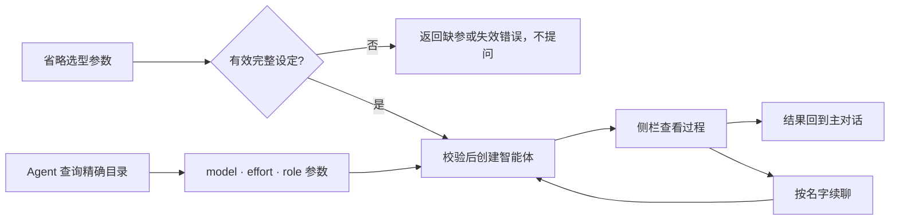

<div align="center">

# dsh-cliworker-now

**简体中文** | [English](README.en.md)

**在 DeepSeek Harness 里，给不同 CLI 一个共同的协作空间。**

选择 CLI、模型和角色，派出有名字的智能体；在侧栏查看过程、接收结果，并继续同一个任务。

[](https://github.com/SuperWheel/dsh-cliworker-now/releases/latest)
[](https://github.com/deepseek-ai/deepseek-harness)
[](#支持的-cli)
[](LICENSE)
[](https://dshfind.com/zh/plugins/SuperWheel/dsh-cliworker-now?ref=badge)

[安装](#安装与更新) · [开始使用](#使用方法) · [常见问题](#常见问题) · [反馈问题](https://github.com/SuperWheel/dsh-cliworker-now/issues)

</div>

## 这是什么

dsh-cliworker-now 是 DeepSeek Harness 的**多 CLI 智能体插件**。它把终端里的 AI CLI 接进 Harness：主对话负责派遣和接收结果，右侧栏用 Harness 原生的完整对话视图展示每个智能体的过程、用量和状态。

你仍然使用各 CLI 自己的账号、模型和原生会话；插件负责把它们组织起来。插件不附带模型服务、订阅或 API 额度。

- **开发协作**：让 Codex 审查代码，再按同一个名字继续追问。
- **写作与审校**：为逻辑、文风、商业审稿和正文修订配置不同角色。
- **长任务跟进**：独立对话和执行记录都保留，任务结束后可以接着做。

安装后在 Harness 中显示为 **CLI Worker / CLI Worker Now**。

## 特点

- **一个入口，多种 CLI**：在主对话点名 CLI，侧栏按 CLI 分组查看全部任务。
- **原生对话体验**：子会话直接使用 Harness 的对话视图、输入框、模型与权限控件、“+”菜单和用量统计，支持排队、停止和结束后续聊。
- **保留原生能力**：每个 CLI 使用自己的协议、登录和会话；模型与思考强度按 CLI 实际目录和当前账号读取，不照搬其他 CLI 的规则。
- **有名字、有角色的智能体**：唯一名称、角色预设和自定义提示词，可按名字反复调用。
- **可控调度**：首次使用前必须明确选型；同一会话互斥，同一目录的写任务串行；CLI 失败时不会悄悄换用另一个。
- **目标、规划、反馈与分支**：在 CLI 子会话中使用 Harness 的这些功能；CLI 不支持的入口会说明原因。

## 界面效果

以下截图来自 Harness Desktop 的真实演示会话（v0.6.5 时拍摄，界面细节以当前版本为准）。


| 角色预设 | CLI 连接与模型偏好 |
| --- | --- |
|  |  |

## 支持的 CLI

| CLI | 原生通路 | CLI | 原生通路 |
| --- | --- | --- | --- |
| Antigravity | stream-json | OMP（Oh My Pi） | RPC |
| Codex | app-server | Pi | RPC |
| Claude Code | stream-json | Hermes Agent | Runs API |
| Kimi Code | ACP | OpenCode v1 / v2 | HTTP + SSE |
| 官方 MiMo Code | HTTP + SSE | Qoder CLI | ACP |
| ZCode | app-server | Qoder CN CLI | ACP |
| Grok Build | ACP | Cursor Agent（fork 新增） | ACP |
| MiniMax Code（fork 新增） | ACP | | |

AGY 模型目录预检使用独立的60秒有界预算，其他 CLI 的通用默认仍为15秒，不改变模型任务时限。内部期限、调用者取消和清理不确定分别报告；设置检查、身份与进程使用同一已选 default/lxy HOME。原有账号、精确模型、权限及排队后重验保留，不用目录成功或 Worker 入队冒充真实生成。实现与实际验收边界见[目录预检修复](openspec/changes/fix-agy-catalog-preflight/design.md)及[验证记录](doc/tasks.md)。

OpenCode v2 已接入 Linux 现有受信原生服务的**显式只读纯文本**任务（`read_only`）、自有会话续聊和有证据的停止。全部原生工具拒绝，不提供文件工具、编辑、shell、MCP、附件、分支或实时引导；会话内模型固定，改模型需新建任务，原生 variants 保持精确标识。缺服务显示不可用而非登出；不自动启动服务，不读取或复制凭据数据库，不回退 v1。未知准入或远端停止未确认会持久隔离，本地桥退出或暂时空闲不能替代停止证据。账号终端由用户主动操作。当前通过的是实际 Host/bridge、官方 DSH 子会话与**合成 v2 服务**的集成回归；真实 OpenCode 服务/模型、GUI 和非 Linux 尚未验收。v1 能力保留。

Kimi 2.2 的 API 状态、模型来源与绑定共用原生凭据解析：识别内联密钥、按提供商类型对应的私有 `env`，以及明确声明的 `apiKeyEnv`。仅显式引用所需的值经过私有子进程环境传递；引用缺值或冲突不改用另一把密钥。API 配置不冒充 OAuth 登录；全局 `KIMI_MODEL_*` 覆盖及额外模型协议暂未开放，真实请求与旧界面问题仍需另行验收。

Cursor Agent 使用 `cursor-agent acp`，保留参数化模型 ID，当前适配仅提供默认思考强度。2026-10-24 父会话在旧在线数字身份修复包上核对了真实只读生成、同会话记忆、Read 文件、停止与停止后续聊；工作目录通知被额外派遣的问题另列修复，不算正常轮次通过。新控制面、换模、独立 effort 控件、工具桥、附件、写入/模式、GUI 和 Windows 仍未验收。账号状态来自原生 `status --format json`，不复用 DSH 或其他 CLI 凭据。

准备期诊断源码候选会分别显示固定 `resolve/spawn/read/exit/timeout` 阶段、安全原因与可确认退出码；这是身份元数据调用故障，不是已登出或额度耗尽的证明。另一次账号/目录成功也不等于准备请求已成功；不自动重试、换号或改模型，取消与清理未确认仍优先。当前只有合成验证，真实原因及恢复状态待正规部署后核对，见[诊断变更](openspec/changes/diagnose-cursor-preparation-metadata/design.md)。

Cursor 本次结果投影增量仍为源码候选：已核实形状的诊断正文（包括无法区分的合法引用）仅标为待核实，普通 error 词与 JSON 不当作失败；严格关联本轮原生工具负证据才判失败。可撤销的工具终态延至整轮收尾确认，未知工具保持 UNKNOWN，后续队列暂停且不自动重试。完整本轮正文、正常文件内容和 diff 保留；未知原生错误样式、被 CLI 丢弃的 read 错误/ls 超时无法猜回。当前验证仅为[固定源码合同与合成回归](openspec/changes/fix-cursor-outcomes/source-contract.md)，不是本次增量部署、真实负向或 GUI 验收。本地明确拒绝权限时，仅本轮唯一有效工具 ID 在最终收尾投影失败；后续 ID 复用则保持未知，不据工具 `completed` 覆盖拒绝事实。仅 read 缺已核实的原生正证据时为 UNKNOWN/UNCERTAIN，正常 raw 文本（包括空文件）保留；不能从无输出猜出已读或底层错误。本增量不批准任何权限、不加 force、不自动重试。

MiniMax Code 与 MiMo 独立，支持 `mmx` / `mcode` / `minimax` / `minimax code`；稳定入口为 `~/.minimax-code/bin/mcode`。本 fork 首阶段仅支持标准 prod 原生 token_plan OAuth，数据目录由 `minimaxHome`、当前 `MINIMAX_DATA_DIR` / `MAVIS_DATA_DIR` 或 `~/.minimax` 决定，不自动选其他账号。模型和强度来自认证后的 ACP 实际回执，执行前确认 Ask 权限；Plan、附件、工具注入、分支与 steer 暂未开放。2026-10-24 源码修正了标准托管显式 baseURL 加原生 `sk-xxx` 占位 key 的误拒，仍须通过原有 OAuth 身份检查；占位本身不授权，API/BYOK 仍未开放。路由和稳定身份增量已由父会话部署；实机回执已定位某广告配置被原生 reasoning 策略拒绝，不能归为未登录或整模型不可用。用户原生终端另报告 M3.1-Flash、Effort max 正常生成。本次功能候选仅隔离精确配置拒绝，以同进程干净会话验证其它项并明确提示已验证子集；当前精确model/effort不发冗余setter，不猜参数或改用户默认。未知错误、15秒/来源/清理门禁保持；待父会话正规部署后真实选型、生成/编码/续聊/停止验收，不宣称已通过。模拟通过不代表真实模型、侧栏或 Windows 验收。

MiniMax 配置绑定按完整内容而非 inode 标识来源；安全同内容原子保存可保持账号绑定，操作内另有有界私有版本检测原地触碰或已观测的内容变化。凭据、认证状态和身份缓存仍保留完整文件戳校验。仅最终快照不能证明原子写入者，也不能完整检测未观测的 atomic A→B→A；本功能候选不宣称完整文件事件溯源，仍待父会话真实验收。

- **系统**：macOS / Windows。外部 CLI 需安装对应系统的原生版本，并完成该 CLI 自己的登录或 API 配置。
- **宿主**：DeepSeek Harness（当前随包资源基于 0.2.1-rc.2）；Node.js ≥ 22.19.0。
- **验证范围**：每个 CLI 的实测版本、已通过和未验证的部分见 [使用细节与 CLI 说明](doc/usage-details.md#42-支持范围与验证边界) 和 [实际验证记录](doc/tasks.md)。能列出模型不代表一定有调用权限。

Qoder、Claude Code（含 CC Switch）、ZCode、Hermes 等 CLI 的安装、登录和路径说明见 [使用细节](doc/usage-details.md)。

## 安装与更新

先结束活动任务并完全退出 Harness，再执行：

```sh
dsh plugin --profile desktop add dsh-cliworker-now@latest
```

完成后重新打开 Harness。`dsh` 命令可在 Desktop 菜单“管理 dsh 命令…”中启用。Web profile 把 `desktop` 换成 `web`；也可以在插件页“添加插件”中输入 `dsh-cliworker-now@latest`。

- 启动 Harness 不会自动更新插件。pnpm 11 默认等待新版本发布满 24 小时，期间可能仍装到旧版，可用 `dsh plugin --profile desktop ls dsh-cliworker-now --depth=0` 核对。
- 备用安装包：`dsh plugin --profile desktop add https://github.com/SuperWheel/dsh-cliworker-now/releases/download/v0.8.2/dsh-cliworker-now-0.8.2.tgz`，每个 Release 附 `SHA256SUMS.txt`。
- 安装包自带原生子对话所需的界面扩展，无需手工构建宿主；卸载插件即恢复官方界面。与已有界面覆盖冲突时启动预检会明确拒绝，不改动你的配置，详见 [runtime-host](runtime-host/README.md)。
- 卸载：`dsh plugin --profile desktop remove dsh-cliworker-now`，保留本机账号、历史会话和偏好。

<details>
<summary>从 GitHub 源码安装或开发</summary>

需要 Node.js ≥ 22.19 和可直接调用的 pnpm 11.25.0：

```sh
dsh plugin --profile desktop add github:SuperWheel/dsh-cliworker-now
```

或本地构建后链接安装（源码目录需保留）：

```sh
git clone https://github.com/SuperWheel/dsh-cliworker-now.git
cd dsh-cliworker-now
pnpm install --frozen-lockfile
pnpm --config.verifyDepsBeforeRun=false build
dsh plugin --profile desktop add .
```

遇到 `ERR_PNPM_GIT_DEP_PREPARE_NOT_ALLOWED`、`ERR_PNPM_IGNORED_BUILDS` 或固定提交等情况，见 [安装细节](doc/usage-details.md#5-安装与更新)。

</details>

## 使用方法

### 1. 派遣

在已选工作目录的主对话里明确说出 CLI，例如：

> 用 Codex 检查这个项目的登录错误处理，把这个智能体命名为“代码审查员”。

也支持简称：`agy` → Antigravity，`glm / zhipu / 智谱` → ZCode，`harmes` → Hermes Agent。名称不明确时只返回候选，不会自动派遣。

由 Agent 在 `cliworker_start` 参数中指定 **model、effort 和可选 role**，插件不再弹出选型、角色或沿用问题卡。先用 `cliworker_models({cli})` 查精确模型/强度，用 `cliworker_roles()` 查角色预设 ID；`role="none"` 表示无预设。省略参数时复用本父对话或同项目同 CLI 的有效完整设定；首次显式模型且省略角色则不使用预设。缺少模型或无法确定强度时返回 `MODEL_REQUIRED` / `EFFORT_REQUIRED`，不猜测、不启动、不保存半套设定。原生登录与权限审批门禁不变。



AGY 切换账号或旧绑定失效时，可先调用 `cliworker_models(cli="agy", agy_account="lxy")`（或 `default`）只读查询目标账号，再将精确模型/强度和同一账号传给 `start` 或 `configure_conversation`。显式查询回执为 `scope="explicit-account-read-only"`，不确认或修改已有选型，`configuredModel` / `configuredEffort` 为 `null`。省略账号仍校验原绑定；Worker 查询不接受账号覆盖。查询过程中的原生账号稳定性检查不变。

### 已有选型后的显式换模型（Agent 控制面候选）

新 Worker 可直接通过参数指定首轮模型，无需问题卡或旧模型空任务。标题或正文写“Opus”不会切模型；配置也不代表执行：

```text
cliworker_models(cli="minimax")
cliworker_roles()
cliworker_start(cli="minimax", title="任务", prompt="实际任务", model=<精确ID>, effort=<有效强度>, role="none")
```

```text
# 同一题先 Argon，再在同一个原生会话使用另一模型
cliworker_models(worker_name="已有智能体名")
cfg = cliworker_configure(worker_name="已有智能体名", model=<目录精确ID>, effort=<目录有效强度>)
job = cliworker_followup(worker_name="已有智能体名", prompt="继续审阅", expected_model=cfg.configuredModel, expected_run_id=cfg.previousRunId)
cliworker_result(worker_id=job.workerId, run_id=job.runId)

# 新题第一条 prompt 就是新模型，仅修改本父会话已确认设定
cliworker_models(cli="agy")
cfg = cliworker_configure_conversation(cli="agy", model=<目录精确ID>, effort=<目录有效强度>)
cliworker_start(cli="agy", title="新题", prompt="实际任务", expected_model=cfg.configuredModel)
```

`expected_model` 必须取配置回执的实际 `configuredModel`（包括原生 effort variant 后缀），不是目录分组别名；它只校验，不选型。第二条路径没有完整设定时返回 `FIRST_SELECTION_REQUIRED`，改用 `start(model=…, effort=…, role=…)` 建立设定，不弹问题、不先跑旧模型空任务。它不改项目默认、其他主对话或已有 Worker；忙碌、待发消息、账号变化及固定模型通路仍拒绝。结果按 `nextCursor` 分页；`configuredModel`、`observedModel`、`targetModelVerified`、原终态和 `cleanup` 分开，失败/中断的部分正文不是新一阶段完成，旧轮缺证据保持未知。仅包版本 `0.8.2` 不证明控制面已上线，需核对新工具 schema、`controlApiVersion: 1` 和实际回执；源码候选与在线旧包及真实验收分开记录。

### 2. 查看、停止与继续

- 点击侧栏任务卡片，在右侧打开该智能体的原生对话；关闭侧栏不会停止后台任务。
- 输入框下方的“+”菜单与原生一致：**添加**（文件、图片、目标、计划、反馈）和**指令**（权限、模型、分支）。
- 运行中可停止；停止只在进程完全退出后才报告成功。运行中发送的消息按原生 Inbox 规则排队或引导。
- 本轮结束后，可以直接在子会话里继续，也可以在主对话说：“让代码审查员继续检查测试覆盖。”
- 右键任务卡片可改标题、改名或删除；已删除的空闲任务可以恢复。

### 全局并发与公平排队（源码候选）

设置页的“并发与排队”，或正式工具 `cliworker_concurrency` 可读取 `globalActive/globalQueued/limit` 和本父会话计数，不暴露其他会话身份或任务。明确传 `limit: 8` 等1–12整数才修改**所有CLI/父会话共用**的预算；保存成功立即释放可运行队列，无需重载/重启。提高不改账号/模型/权限，降低不停止已在途任务，暂时active高于limit正常。私有明确选择优先插件初始配置及默认8；旧profile如明确存2仍保留初始2，直到正式入口明确选择新值，坏记录不悄悄退默认。

队列按父会话轮转、各父会话内部FIFO；前方同目录写任务仍是屏障，不抢占别人的运行。任务卡说明真实的全局容量、项目写冲突或准备阶段；占位含授权、子会话准备及清理，不等于已请求模型，也不是全部元数据子进程数。设置页计数是可刷新的读取快照，不冒称实时订阅。queued新任务尚未落账号绑定时会提示 `PENDING_ADMISSION`，可等准入或用明确 `cli` 查目录，不该重复新建或误判登录失败。源码/模拟/预览、实际安装与线上明确调参分别核验。

**DSH宿主还有独立的 active-child 门禁**：它按连续 managed root pool计槽，不是AGY配额，也不是插件跨会话global预算；插件设12不保证某root能派12。新延期准入候选仅在SDK确证容量拒绝、未发布child且临时绑定已安全回滚时让原Task/Worker/run保留排队，显示 `host-child-capacity`，释放插件槽、不重复发题、不算已审。公开释放/配置事件优先唤醒，SDK不发end的启动回滚由2–30秒one-shot低频补偿；等待不消耗真正执行timeout。未知delivery、权限或清理不确认不自动重试；插件不读取private pool或自动提高Hostpolicy，旧failed记录不冒改为成功。宿主政策只能由操作者经官方Subagent设置/Settings API另行明确调整；延期源码候选是否安装与真实验收仍须单独核对。

### 3. 角色与 CLI 设置

| 设置 | 作用 |
| --- | --- |
| 智能体设置 | 管理“名称 / 概述 / 角色提示词”预设；内置七种小说创作角色，见 [角色预设](doc/role-presets.md) |
| CLI 连接 | 每个 CLI 单独开关、查看登录状态、打开原生账号终端；高级设置可指定 CLI 路径 |
| 项目默认设置 | 保存当前项目的默认模型与思考强度 |
| 子会话控件 | 用原生模型、权限控件修改当前智能体；运行中或有待发消息时锁定 |

### 4. 目标、规划、反馈与分支

| 功能 | 行为 | 支持范围 |
| --- | --- | --- |
| 目标 | 目标栏、“+”菜单或 `/goal` 设置；活动目标随每轮输入发给 CLI，不会自动发起新一轮 | 全部 CLI |
| 规划 | 映射到 CLI 原生的规划或只读模式；不支持的 CLI 不显示规划按钮，“+”菜单说明原因 | Hermes、MiniMax、Qoder、Qoder CN 及旧版 Kimi 通路不支持 |
| 反馈 | 赞、踩和反馈只记录在 Harness，不发给 CLI 或厂商 | 全部 CLI |
| 分支 | 从完成的轮次创建 CLI 原生分支，在同一主会话下生成新的子会话 | 最新轮：Codex、Claude Code、Kimi（ACP）、MiMo、ZCode、Pi、OpenCode v1、Qoder、Qoder CN；较早轮次仅 Codex；OpenCode v2 不支持 |

## 权限与数据

- **按明确选择执行**：CLI 缺失或失败不会换用其他 CLI；不接管插件外启动的 CLI。
- **原生权限**：使用各 CLI 自己的权限模式，不附加系统沙箱；Harness 处于规划或只读模式时拒绝写任务。
- **两层结构**：主对话 → 直接子智能体，不支持递归派遣。插件全局默认8个运行槽，可在线设1–12；不是AGY或其他厂商配额。同会话互斥、同目录写任务仍串行。
- **数据在本机**：记录保存在 `~/.dsh/cliworker-now`（目录 `0700`、文件 `0600`）。CLI 仍会按自己的配置向服务商发送模型请求。
- **用量有来源**：只显示 CLI 提供或可核查的数据；未知项显示 `—`，不补零、不估算冒充。

## 常见问题

<details>
<summary><strong>终端里装了 CLI，Desktop 却找不到？</strong></summary>

Desktop 不读取 `.zshrc`。插件会识别常见安装位置；仍找不到时，在该 CLI 设置的“高级设置”中填写可执行文件的完整路径。

</details>

<details>
<summary><strong>更新后模型菜单报错或出现 HTTP 404？</strong></summary>

结束运行中的任务后，完全退出并重新打开 Harness。只刷新插件列表可能留下旧 Host 与新 Client。

</details>

<details>
<summary><strong>已登录为什么调用仍失败？</strong></summary>

订阅、计费和模型权限由各 CLI 的服务商决定。能登录或列出模型不代表一定能调用，遇到 403 等错误请核对该 CLI 的账号权限。

</details>

<details>
<summary><strong>已经有回复，为什么结尾仍报中断或无额度？</strong></summary>

本轮正文、工具结果、进程退出与 CLI 汇总是不同证据。AGY 的旧会话可能在换模型并生成新回复后，仍重复此前的额度错误；旧汇总、倒计时或模型列表都不是当前余额查询，也不能据此否认已生成的结果。有输出同样不能抹掉真实的后续错误。

本轮[修复方案与验收](openspec/changes/fix-worker-history-repro-gaps/tasks.md)只在严格完成条件下将汇总冲突标为“结果待核实”，不判成功、不自动重试；新任务准入失败也不等于账号已退出。当前源码回归不代表已经部署，真实验收与安装状态以该清单的实际记录为准。

</details>

<details>
<summary><strong>为什么没有思考强度或上下文百分比？</strong></summary>

插件只提供 CLI 明确支持的强度；CLI 没有提供可核查的上下文数据时显示 `—`，不会按模型名猜测。

</details>

更多账号、路径和模型规则见 [使用细节与 CLI 说明](doc/usage-details.md)。

## 开发

TypeScript ESM + React：Host 管理进程与持久化，Client 只通过 Harness Gateway 访问 Host。

```sh
pnpm install --frozen-lockfile
pnpm typecheck
pnpm test
pnpm build:preview   # 隔离包：.cache/preview-package
pnpm build
```

变更用 [OpenSpec](doc/openspec.md) 管理（`pnpm spec:list`、`pnpm spec:check`）。真实 CLI 验收会消耗账号额度，入口为 `pnpm smoke:extended --help`；Windows 远程测试见 [指南](doc/windows-remote-testing.md)。

## 文档

- [使用细节与 CLI 说明](doc/usage-details.md)：各 CLI 的账号、路径、模型规则及完整安装说明
- [设计与协议](doc/design.md) · [原生通信说明](doc/native-protocols.md) · [原生界面说明](doc/native-conversation-ui.md)
- [任务与实际验证](doc/tasks.md) · [历史版本与配置](doc/version-notes.md) · [文档索引](doc/README.md)
- [提交 Issue](https://github.com/SuperWheel/dsh-cliworker-now/issues)：请附 Harness / 插件 / CLI 版本、复现步骤和脱敏日志，不要上传令牌或私人项目内容。

## 许可与致谢

[MIT License](LICENSE)。本项目是独立社区插件，DeepSeek Harness 及各 CLI 的名称和商标归各自权利人所有，不表示官方关联或背书。

感谢 [codex-host](https://github.com/BytePioneer-AI/codex-host)、[Codingns4DSH](https://github.com/jingyi0605/Codingns4DSH) 和 [DeepSeek Harness](https://github.com/deepseek-ai/deepseek-harness) 的作者与贡献者，以及 [Codex](https://github.com/openai/codex)、[Hermes Agent](https://github.com/NousResearch/hermes-agent)、[Kimi Code](https://github.com/MoonshotAI/kimi-code)、[Grok Build](https://github.com/xai-org/grok-build)、[Pi](https://github.com/earendil-works/pi)、[Oh My Pi](https://github.com/can1357/oh-my-pi)、[OpenCode](https://github.com/anomalyco/opencode)、[MiMo Code](https://github.com/XiaomiMiMo/MiMo-Code) 和 [ZCode](https://github.com/zai-org/ZCode) 的开发者公开源码与协议文档。参考范围见 [CLI 数据接口核查](doc/cli-native-data-audit.md) 与 [Codingns4DSH 参考记录](doc/codingns-reference-audit.md)。
