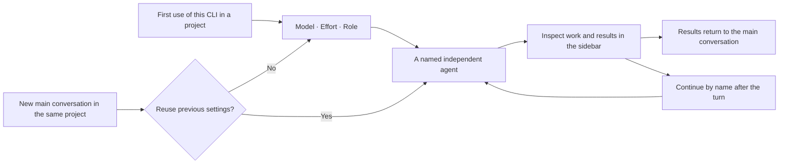

# Usage details and CLI notes

[简体中文](usage-details.md) | [English](usage-details.en.md) · [Back to README](../README.en.md)

This page keeps the full text from before the README was shortened in v0.8.2: per-CLI account, path and model rules, installation details, running-message and compatibility behavior, and development commands. Section numbers follow the former README. See [version notes](version-notes.md) for per-release changes and the [implementation log](tasks.md) for actual verification.

## Native conversation notes


The latest published version is **v0.8.2**. The v0.7.10 source, uncommitted work and build were independently backed up and verified before the v0.8.1 native-conversation and tool-bridge migration. Subsequent unreleased fixes keep the existing version until an explicitly authorized release. Bug fixes use focused verification; final full-suite results and any unverified macOS/Windows boundaries are recorded separately rather than inferred from a local pass. Actual results and verification boundaries are recorded in the [implementation log](tasks.md).

Qoder bills in credits. Turn usage displays confirmed `CLI/provider/model` identities, such as `omp/zhipu-coding-plan/glm-5.3-flash`, rather than internal Worker routes; undisclosed providers stay explicit. Its composer and completed-turn usage indicators display the credits for their exact bound run and its dialog is titled “Credits usage”, without token units in that module; missing credits remain unknown. A verified native context percentage remains visible without a token count or window; an actual same-turn native window may supplement an explicitly estimated count. Windows supports Qoder's native administrator ownership and inherited read-only ACLs while rejecting untrusted writers and preserving file permissions. This fix was checked on Windows Desktop using existing history and focused regressions; no new model calls or Mac tests were run. See the [Qoder protocol notes](qoder-protocol.md#63-积分计费显示2026-10-18).

The current v0.8.1 migration runs the complete official `sidebar.chat.conversation` view and its state logic inside the right CLI Worker sidebar, while retaining the original parent management page. Its top area retains the original Worker back button, title and task actions; it does not add main-page breadcrumbs, Chat/Trace tabs or header utilities. Opening a Worker leaves the main page in place. Each child stays bound to its parent and excluded from ordinary session lists; CLI Worker retains task management and read-only legacy history. The CLI keeps its own Agent, account, selected model, session identity and transport. Native sending, queue editing/removal and stopping use the actual DSH Session and Inbox. The official view owns transcript, composer, queue and running state, retaining the native keyboard, Store and slot ownership.

Model/effort and permission/planning controls are the actual native components, with their public data and save callbacks connected to the selected CLI. Settings remain locked during execution, admission or cleanup, and while any native inbox item or compatibility queue item exists, including paused items. The user-authorized four-package host extension ships with this plugin and supplies main-conversation button presentation and session-scoped telemetry sources. See the [source and rollback contract](native-conversation-host-extension.md). Native ContextMeter and StatsPills consume verifiable telemetry for the exact Worker. All three native modules remain visible while data is unknown, showing “—” and explaining the reason in native details. Context never uses DSH display estimates or cumulative tokens as a substitute. Hermes public request/error observations update independently of message events; only received public reasoning and tool events enter native process views. Unsupported attachments and forks keep specific reasons, while available commands remain usable. These adapters apply only to the exact bound child.

Permission controls map the CLI's planning and edit modes to the native read-only and workspace-write presets. Saving and execution retain the CLI's actual modes; this mapping adds no full-access or automatic-approval capability.

The [eleven-CLI data interface matrix](cli-native-data-audit.md) distinguishes model responses, complete runs, session totals and current context. New Workers use the migrated transports; historical Workers retain their saved protocol. The current candidate adds Kimi's durable receipts for the exact session, official request observation inside the existing Hermes process, OMP's native context categories and explicit extra billing fields, and OpenCode's native session counters. OMP's retained records do not establish full historical billing; OpenCode snapshots may decrease or reset. Only complete receipts supply native turn totals, and missing cache or context categories stay unknown. Native details retain scope, source and estimate labels.

The final section 11 preview passed: **295 integration tests across 17 files**, **211 host tests** and **11 context tests** in separate groups, plus the final **12 Hermes** and **29 ZCode** focused checks. These groups overlap and must not be added together. Isolated real single-turn checks using saved selections passed tool artifacts and receipts for Antigravity, OMP, Pi, OpenCode and ZCode. Codex was blocked by account quota before process admission; Hermes was blocked by HTTP 429 capacity errors from the selected upstream model. Kimi had no subscription, while Claude, MiMo and Grok had no saved selection; those four CLIs were not started. Native browser acceptance used explicit simulations and does not verify real follow-up, cancellation or Windows behavior. The four-package candidate is `artifacts/dsh-host-extension-rc2-data/`. **The plugin and four native host extensions are installed in Desktop and passed cold-start UI acceptance.** The actual Hermes history shows 3,901 tokens for its last run and 8,669 for its session; AGY shows all three native statistics and its context source. This does not imply that every CLI or every upstream field passed real execution. See the [verification record](tasks.md) for evidence and limits.

Native next-step messages follow the current CLI transport. A supported and ready in-run steer channel uses the CLI's actual acceptance receipt. Without that channel, input stays queued until the complete CLI run and cleanup finish, then continues the same CLI session at the next execution step; it does not interrupt/restart the run or claim live injection. Rejected or uncertain steering is not automatically converted into a later run or resent. Codex app-server, Hermes HTTP, Pi RPC and OMP RPC steering are connected and covered by simulated protocols and the real DSH Inbox; this does not establish fresh real-account or model acceptance for every CLI. Request identities and acceptance receipts persist, while old Worker queues are neither imported nor executed automatically.

The tool bridge inherits the child's configured skills, MCP and tools, rechecks access and uses DSH's permission pipeline. Extra DSH model calls remain blocked; ordinary parent models retain their behavior. Earlier partial-content embedding, internal input proxies and full-page navigation have been superseded by this sidebar design, with historical records retained. Actual sidebar, control, telemetry and steering acceptance is tracked in the [implementation log](tasks.md). See the [native UI contract](native-conversation-ui.md) and [tool bridge boundaries](native-harness-tools.md).


When a resumed AGY turn has a complete reply but its final aggregate reports ERROR, sufficient conflicting evidence produces an `uncertain` outcome. The current reply and original error remain available; this does not establish success or prove that the error is historical. Verify actual results before retrying writes. Harness jobs support only completed/failed/killed, so the outer job remains failed with an explicit uncertainty notice and structured outcome. Current errors, nonzero exits, partial output and cancellation retain their failure or interruption outcome.

The new Native-stream candidate uses `CLI_RESULT_UNCERTAIN` for AGY/Cursor uncertainty and retains an error finish. The pinned SDK has no uncertainty terminal, so its built-in turn may still show red Failed; the explanation explicitly identifies that compatibility limit, without claiming success or a proven business failure. Historical turns are not rewritten. `CLI_OPERATION_CANCELLED` indicates cancellation, not zero execution. Opaque exceptions are not stringified directly; unconfirmed cleanup or delivery remains higher priority. Check this run's receipt and actual artifacts before retrying. Deployment and new-stream GUI acceptance remain separately recorded in the [implementation log](tasks.md).

Finished empty intermediate replies appear in the expandable work process with their usage, timestamps and reported duration. Task duration uses local timing for this run; upstream AGY duration and usage are labelled as conversation totals and are never added to step values. Streaming replies, tools and errors remain visible.


The native CLI plus menu matches the native menu: an Add section (file, image, goal, plan, feedback) and a Commands section (permission, model, fork), with native icons and labels; a typed query uses the native ranking. It offers Desktop file references on macOS/Windows and Harness image uploads. Admitted native attachment blocks are converted to each CLI's supported content blocks, resource links or file paths. Generic browser file receipts remain unavailable in rc.2 child sessions. Attachment identities participate in retry deduplication; uploads submitted during generation stay in the native queue. Harness Skills and configured MCP tools reuse the scoped Host bridge and approval pipeline. ACP approval is limited to exact, currently granted bridge tools. See the [per-CLI capability matrix](cli-harness-capabilities.md) for limits and platform evidence.

## 4. Requirements and CLI support

### 4.1 Requirements

| Component | Requirement |
| --- | --- |
| Operating system | **macOS / Windows**; each external CLI needs its native installation for that system |
| Host | **DeepSeek Harness**; required interfaces are checked without rejecting the host solely by version. Release notes record tested versions; optional native-view extensions are built and verified against their corresponding official source |
| Node.js | **22.19.0 or newer** |
| External CLIs | Install only those you need, with their own account or API access; the OMP npm package needs Bun ≥ 1.3.14 |
| Install command | Enable `dsh` from Desktop’s Manage dsh Command menu; macOS and Windows share the same syntax |
| Source development | pnpm **11.25.0**, as pinned in the repository |

The plugin package and Harness UI are not restricted to macOS. Worker execution uses each CLI's native protection and permission options; the plugin adds no operating-system process sandbox. Windows x64 previously passed runtime and own-account source tests for all 11 CLIs, plus actual Codex/Pi/OMP startup and Pi SDK metadata checks. Those historical results do not verify the new transports on a Windows machine. Individual CLI installations and live model access remain separate requirements.

### 4.2 Adapter coverage and verification

New v0.7.10 Workers use native duplex transports: Codex app-server, Claude/Antigravity stream-json input/output, Kimi/Grok ACP, ZCode app-server, OpenCode/MiMo HTTP+SSE, and Hermes Runs API. Pi/OMP retain their native RPC bridge. Existing Workers keep their original session transport; the plugin does not silently switch models or protocols. The table below preserves historical checks. See the [transport contract](native-protocols.md) and [verification log](tasks.md) for acceptance of the new paths.

An integrated adapter does not mean every model, subscription or platform has been tested. The table preserves historical live checks. Account isolation and model permissions were tightened in later releases, so an earlier successful task does not establish current access. During v0.7.9 development, macOS Antigravity and Codex live conversations were checked for the affected message and stop flows. Cross-platform release checks cover automated regressions and isolated installation/lifecycle checks; they do not establish live generation access for every provider. See the [verification log](tasks.md) for exact scopes.

| CLI | Checked version | Verification scope |
| --- | --- | --- |
| Antigravity | 1.2.16 | Live first turn, follow-up and stopping verified |
| Codex | 0.160.0 | Live first turn and continuation of the same native session verified |
| Claude Code | 2.1.176 | Live first turn and follow-up verified; `sonnet` mapped to GLM in that test environment |
| Kimi Code | 2.1.1 | Native token status, account identity and login management checked; an earlier 0.42.0 live request was blocked by subscription HTTP 403; generation has not been repeated |
| Official MiMo Code | 0.1.15 | Live first turn and follow-up verified |
| ZCode | 0.16.9 | Native authentication, headless execution and session protocol integrated; see its probe record |
| Grok Build | 1.0.0 | Own login, official Build access permission and model directory checked separately; generation remains unverified |
| OMP | 16.4.4 | Native login/logout menus and own log-write permissions checked; RPC integrated; Zhipu Coding CN GLM-5.3-Flash was tested historically |
| Pi | 1.0.2 / 1.0.4 / 1.1.0 | Executable identity and SDK/RPC checked by version; 1.0.2 with Zhipu Coding CN GLM-5.3-Flash was tested historically; 1.0.4 checks were read-only or offline; 1.1.0 passed credential-free SDK/RPC, native login menu display and termination cleanup on Windows, with live login and model execution still unverified |
| Hermes Agent | Installed checkout 6c80c32734 | Own account directory, native account menus and Nous model access checked; a read-only check returned 10 free models; generation and continuation remain unverified |
| OpenCode | 1.18.21 | Native model directory and JSONL adapter integrated; Zhipu models were tested historically; a free MiMo request previously returned HTTP 403 |
| Qoder CLI | 1.1.73 | Native ACP added in v0.8.1; real account metadata and a 17-model dynamic catalog checked; live model tasks, tool artifacts, restoration, in-run cancellation and Windows remain unverified |
| Qoder CN CLI | 1.1.74 | Its own account and 15-model catalog checked on Windows; Qwen3.8-Flash / low passed generation, file tools, same-session continuation and in-run cancellation; a separate normal new-chat dispatch and native child UI check also passed; other models and the Mac runtime remain untested |

MiMo refers to [XiaomiMiMo/MiMo-Code](https://github.com/XiaomiMiMo/MiMo-Code). Hermes Agent replaced the old external Harness CLI adapter; DeepSeek Harness remains the plugin's host.

v0.8.1 adds **Qoder CLI** through the official `qoder --acp` interface in the same native sidebar. Models and reasoning efforts come from its structured catalog and are confirmed before sending. Only the edit mode is available: the current ACP implementation advertises no read-only planning mode, so planning tasks fail before prompt admission. Hidden token counts remain unknown, with inspectable usage entries both below the composer and on exactly bound completed messages. A context ratio reported by the exact native session is shown independently; missing token counts, capacity, cache and categories remain unknown. Turns and steps describe the host child conversation, not Qoder's internal request count. See the [Qoder protocol checks](qoder-protocol.md).

When an external CLI omits cache usage, the usage control shows “Cache hit —” without an explanatory paragraph. Unknown cache values are not converted to zero. Grok and OMP turns without public process content add no extra notice; published reasoning and tools remain expandable.

OMP catalog refresh first updates the native registry in its plugin-managed runtime directory, then filters by OMP’s own current account scope and quota. Tasks use the same registry. Models absent from the account response are not hardcoded into the menu, and catalog visibility does not establish successful generation.

MiMo reuses a bounded, short-lived in-memory cache of native capabilities to reduce repeated CLI startup on Windows. The first load still queries the native CLI. Changes to the account, configuration, project or executable invalidate the cache, and each dispatch still checks the current account's access.

macOS and Windows share one settings display cache. The first open warms account summaries, models and reasoning efforts for every enabled CLI, with the selected CLI first and at most two warmup jobs. Each job reads its account then its catalog. Closing cancels unfinished work and retains completed receipts; reopening checks lightweight Host/project/source metadata and fills only missing or invalidated entries. Disabled CLIs are not queried. These jobs still follow each native CLI process cleanup rules; the limit does not count every subprocess inside a catalog operation. Current project defaults are preserved, and display caches never authorize selection saves or task execution.

Verified Kimi managed OAuth model capabilities and Claude command-parameter capabilities can also be reused briefly. Each actual catalog rediscovery still checks current credentials, expiry and remote access; remote quota is not cached. Windows launchers hide extra console windows for background queries and embedded account terminals.

Initial warmup, explicit refreshes and automatic model/effort saves retain their account and catalog checks. Reopening a completed display cache does not repeat native queries. For the verified Codex npm 0.162.1 launcher, Windows background calls use the native CLI from the same installation, avoiding an extra terminal created inside the JavaScript launcher. The saved installation path, package-manager environment and process cleanup are preserved. Other launcher revisions keep their existing behavior; see the [verification log](tasks.md) for the observed window coverage.

On Windows, background Antigravity model queries and tasks use the official environment switch to disable auto-update for that child process, preventing its updater from opening another terminal. This does not change updates in user-opened Antigravity terminals or behavior on macOS.

Successful extended-CLI catalog queries remove their private temporary directory and extracted native cache after process exit is confirmed. Failed or unconfirmed cleanup preserves the query files and never deletes native account files.

Probe records: [ZCode](zcode-probe.md) · [Grok](grok-probe.md) · [Pi / OMP](pi-omp-probe.md) · [Hermes](hermes-probe.md) · [OpenCode](opencode-probe.md) · [Qoder](qoder-protocol.md) · [Qoder CN](qodercn-protocol.md)

### Qoder CLI installation and login

Follow [Qoder's official installation guide](https://docs.qoder.com/cli/installation). The recommended macOS / Linux entry is:

```sh
curl -fsSL https://qoder.com/install | bash
```

On Windows PowerShell:

```powershell
irm https://qoder.com/install.ps1 | iex
```

With Node.js installed, the official npm compatibility entry remains `npm install -g @qoder-ai/qodercli`. Run `qoder --version`, then `qoder login` and complete its native browser flow. The CLI also supports its own `QODER_PERSONAL_ACCESS_TOKEN`; keep tokens out of chat and the repository. This integration did not install Qoder or sign in automatically.

**Qoder CN CLI** is a separate `cli=qodercn` entry, with `~/.qoder-cn`, `QODERCN_PERSONAL_ACCESS_TOKEN`, its own account, preferences and `qodercn-acp-v1` sessions. Its npm compatibility package is `@qodercn-ai/qoderclicn`. Windows discovers the native `~/.qoder-cn/bin/qoderclicn/qoderclicn.exe` and validates same-brand npm entries. A generic “use Qoder” request selects the only installed edition; when both are installed, it returns ambiguous candidates and requires an explicit `cli=qoder国际版` or `cli=qodercn`, without a version question. Explicit edition requests never fall back to the other edition. Models and reasoning options remain native and dynamic. See the [CN protocol and isolation notes](qodercn-protocol.md) and [official installation guide](https://docs.qoder.cn/cli/installation).

All supported CLIs share bounded Windows discovery through common user bin/npm/Bun/Scoop/pnpm locations and, after inherited PATH misses, the latest user and machine PATH. Edition-specific directories, package identities and native entry checks remain explicit. Unregistered portable locations outside PATH still need a manual path; no arbitrary-drive scans, newest-version guesses or GUI launches are used.

Select Qoder in CLI connections, refresh its models and explicitly choose a model before dispatch. Initialization, authentication and model discovery are separate checks; a successful handshake does not establish live execution. See the [protocol checks](qoder-protocol.md) and [verification record](tasks.md) for account and live-test boundaries.

On Windows, discovery checks the official native `~/.qoder/bin/qodercli/qodercli.exe` and current-user npm entries even when Desktop has not inherited the updated PATH. PATH lookup prefers the standalone `qodercli` command and supports the legacy `qoder` CLI alias when that command is absent. npm entries are checked against the official package's declared bins. Manual paths retain priority; broken or inaccessible entries report an error and can be checked in advanced settings.

Qoder settings combine account and model discovery within each catalog operation to avoid repeated CLI startups. Actual catalog reads still check the current account, and explicit refreshes query again. Reopening completed settings reuses display receipts without another native query. Account and catalog queries use the same installed CLI's official metadata interface, with writable caches and necessary configuration copies in a private temporary directory. Native login and PAT sources are handled separately; the plugin does not decrypt browser account files. Queries clean up after exit and show only enabled models. Legacy project settings requiring native migration, and unbound authentication or runtime declarations in `.env`, are rejected before querying. Real account metadata and catalog checks passed on macOS; PAT, live tasks and other platforms still require separate acceptance.

### Claude Code with CC Switch

On macOS and Windows, the plugin reads Claude Code's current own settings. With routing disabled, sign in to the official Claude account in the plugin account section. With routing enabled, refresh Claude's model list and select a routed model. Official login and logout preserve CC Switch settings.

Native mappings, including Fable and the `[1m]` context suffix, retain their exact execution IDs. When a gateway does not implement model discovery, only its explicitly configured models are shown, with remote availability stated as unverified. Authentication rejection and query errors do not switch to the official account. Select again after changing routes or mappings; an existing task whose source changed requires a new task.

## 5. Installation and updates

### 5.1 One-line install

```sh
dsh plugin --profile desktop add dsh-cliworker-now@latest
```

v0.8.1 includes the four native UI packages required by Worker conversations. Its official bundle layer activates package-relative resources without manual paths, host compilation or application-file changes. Finish tasks and fully quit Harness before installing, updating or removing the plugin, then cold-start it. Removing this plugin withdraws its bundle layer and restores the official UI entries.

Existing UI overrides, disabled entries or settings asserted against an old module source may conflict. The startup preflight checks sources and hashes without writing configuration; it refuses unsafe combinations instead of deleting or migrating user settings. Keep a backup and resolve the conflict, or remove this plugin to restore the previous composition. The official source patch, hashes and licenses ship in [runtime-host](../runtime-host/README.md). The included resources use the official 0.2.1-rc.2 baseline; compatibility is checked through actual interfaces, with verified versions and platforms recorded in the Release.

<details>
<summary>Web, source installation and updates</summary>

For the Web profile:

```sh
dsh plugin --profile web add dsh-cliworker-now@latest
```

Finish active tasks and fully quit Harness before installation or updates, then reopen it. `@latest` resolves the latest npm version under the installer's current rules. Starting Harness does not automatically update the plugin. pnpm 11 waits 24 hours after publication by default, so the command may exit successfully while retaining an older version. Check the installed version and retry after the waiting period, or use the verified release archive below. The npm package is prebuilt and needs no manual extraction or compilation. You can also enter `dsh-cliworker-now@latest` in the plugin manager's Add Plugin dialog.

Run `dsh plugin --profile desktop ls dsh-cliworker-now --depth=0` to check the installed version.

GitHub Release fallback:

```sh
dsh plugin --profile desktop add https://github.com/SuperWheel/dsh-cliworker-now/releases/download/v0.7.9/dsh-cliworker-now-0.7.9.tgz
```

**Install from GitHub source**

Source builds require Node.js ≥ 22.19 and pnpm callable directly from `PATH`; this project pins pnpm 11.25.0. Run `pnpm --version` before installing to confirm the command is available. If pnpm is missing, follow the [official installation documentation](https://pnpm.io/installation) to set up that version. The installer bundled with Harness does not guarantee that pnpm is available to source builds.

To build directly from GitHub:

```sh
dsh plugin --profile desktop add github:SuperWheel/dsh-cliworker-now
```

For the Web profile:

```sh
dsh plugin --profile web add github:SuperWheel/dsh-cliworker-now
```

Without `#`, the source comes from the repository's default branch. The existing `v0.7.8` tag predates this build entry point and cannot be used for this source installation. To pin the source, replace `<full-commit-SHA>` with a full commit SHA that includes the source build entry point:

```sh
dsh plugin --profile desktop add "github:SuperWheel/dsh-cliworker-now#<full-commit-SHA>"
```

This downloads build dependencies and compiles the plugin, so it usually takes longer than installing a prebuilt package. Default-branch source is separate from the frozen npm stable package. Repeating the install command does not guarantee that it follows the latest HEAD; check the resolved commit.

If an installation or update reports `ERR_PNPM_GIT_DEP_PREPARE_NOT_ALLOWED` or `ERR_PNPM_IGNORED_BUILDS`, build approval is required. Find the corresponding profile's `pnpm-workspace.yaml` using the path printed by dsh. Add the exact key from the error to the existing `allowBuilds` mapping with a value of `true`, retain all other configuration and rules, and retry the same install command. If `allowBuilds` is absent, add that mapping without replacing the whole file. A different commit may require another approval using the new error's key.

On Windows, source builds can also be affected by long cache or temporary paths. If dependency installation fails, retry with shorter paths or use a prebuilt installation above.

For source development:

```sh
git clone https://github.com/SuperWheel/dsh-cliworker-now.git
cd dsh-cliworker-now
pnpm install --frozen-lockfile
pnpm --config.verifyDepsBeforeRun=false build
dsh plugin --profile desktop add .
```

The local-directory installation above links the checkout, so retain that directory. To uninstall:

```sh
dsh plugin --profile desktop remove dsh-cliworker-now
```

Uninstalling retains local accounts, history and preferences. Each release includes a `SHA256SUMS.txt` checksum file.

</details>

## 6. Using dsh-cliworker-now

### 6.1 Dispatch your first agent

In a Harness main conversation with a working directory selected, explicitly name the CLI you want to use:

> Use Codex to inspect this project's login error handling. Name the agent “Code Reviewer”.

Short aliases are also supported:

> Use agy CLI to review this project.
>
> Use glm CLI to check this code.

`agy` maps to **Antigravity**, `glm / zhipu / 智谱` to **ZCode**, and `harmes` to **Hermes Agent**. Explicit requests receive a routing hint, and dispatch tools resolve these aliases consistently. Matching parenthesized aliases such as `Antigravity (agy) CLI` and repeated requests for the same CLI resolve to one target. A small spelling error in a longer name is accepted only with one unambiguous match. Unknown names or multiple targets return a short error with candidates and do not start a task. Ordinary model discussion, negated requests and quoted examples do not trigger a routing hint. Harness's main model still decides whether to invoke the tool; if needed, explicitly ask it to “use the CLI Worker plugin to call agy CLI”.

The Agent controls selection through parameters; CLI Worker does not open model, effort, role or reuse question cards:

1. Query `cliworker_models({cli})` for exact model IDs and supported efforts.
2. Optionally query `cliworker_roles()` for preset IDs, names and summaries. Pass `role=<exact ID>` or `role="none"` to start.
3. Supply `cli`, `title`, `prompt`, `model`, `effort` and optional `role` to `cliworker_start`. A first explicit model without a valid complete setup and without a role uses no preset.

Omitted parameters reuse this main conversation's complete setup first, then a valid setup for this project/CLI, without a reuse question. Legacy model/effort-only preferences are incomplete. A missing model returns `MODEL_REQUIRED`; multiple efforts without a reusable value or advertised default return `EFFORT_REQUIRED`. The Agent queries and supplies the missing values; no model is guessed, partial setup saved or Worker created. A stale current-parent setup never silently falls back to another project default. Account, model, policy and cancellation checks still apply. Native login and permission approval are not selection questions and retain their original gates.

Each call must explicitly include `cli`, including Antigravity; a missing selector cannot use a previous/default CLI. Current-step routing explains parameterized dispatch. The ordinary question tool remains unchanged.

All supported CLIs use only their own native login or an API key configured in that CLI's own settings or private `.env`. Models and reasoning efforts are filtered by CLI capabilities and the current account's available scope. Claude's explicit own gateway configuration follows the separate rules in section 4, showing configured candidates with remote availability stated as unverified. A public catalog, old cache, fixed alias or anonymous free model alone does not establish availability. Choices that do not meet these evidence requirements stay unavailable, with a short reason. Permission discovery uses read-only metadata, rather than generation requests.

Model menus show readable names without provider or organization path prefixes or parenthesized notes, and deduplicate the same native model. Distinct models with the same short name remain separate options. Saved choices and execution retain the full route ID. For a new choice, models with confirmed available free allowance appear first; missing prices and default zero-cost metadata are not treated as proof of free access. Existing valid choices remain, and a failed free route never silently becomes a paid request.

**OMP (Oh My Pi) and Pi Coding Agent are separate CLIs.** Their installations, accounts, models and sessions are managed independently. The plugin checks executable identity and does not silently replace an installation with another version.

macOS and Windows share the same account terminal with text selection and copying, Cmd+V / Ctrl+V paste and a blinking block cursor. Right-click copies selected text, or pastes when nothing is selected. Login opens the native authorization page directly; the complete Windows ZCode login URL is also clickable and can be selected and copied into a browser.

Windows discovers the CLI inside the current user’s verified official Codex app package, the official npm entry, and Hermes’s official installation directory. An incomplete installation without an executable is reported explicitly.

Each CLI settings page has a separate **Advanced settings** section, collapsed by default. Use its right-hand arrow to expand and manage the CLI path: the first successful discovery is saved locally and reused, or enter a full file path and click Refresh to update CLI status. Restore automatic discovery removes the local selection. Paths are shared across projects on the same machine and OS; manual choices take precedence over deployment configuration, which takes precedence over automatically saved paths. A missing automatic path triggers discovery again; an invalid manual path remains selected and reports an error. Enter the CLI file, without a desktop GUI, directory, command arguments or surrounding quotes.

Headings, labels, spacing, dividers and controls follow the [shared settings design specification](settings-ui-design.md). Future settings reuse the same parameters.

Windows also discovers ZCode and OpenCode in custom directories through known default directories, per-user/system installation records, image paths of already running product processes, and Start menu/Desktop shortcuts, including non-system drives and paths with spaces or Chinese characters. ZCode requires its bundled CLI and provider file; OpenCode requires a real standalone `opencode-cli.exe`. Desktop versions without that CLI report the missing component. Explicit paths, a deployed ZCode runtime and working PATH entries retain priority. Multiple usable installations require `zcodeExecutable` / `opencodeExecutable`; `DisplayIcon` is an installation registry value, not a requirement for a visible desktop icon. Portable folders in arbitrary locations without registration, shortcuts or PATH still need explicit configuration when the application is not running. Finding the CLI does not establish login or model access.

Windows supports the verified official Pi launcher and the native executable declared by the OpenCode npm package. The plugin parses their fixed launch commands and validates installation identity. Unrecognized or broken entries require an installation check. Other Pi versions require SDK/RPC and native menu verification before support is added.

Desktop installation checks use physical files, accounting for Electron's ASAR handling. A valid OpenCode npm CLI does not require a neighboring desktop archive. No CLI reinstall or account reconfiguration is needed.

Settings prioritize the selected CLI and limit background account checks to two at a time. Verified Kimi OAuth model capabilities and Claude command capabilities can be reused briefly, while credentials, expiry and remote allowance are checked again. Windows metadata and embedded account launchers hide additional console windows. Codex reports confirmed exhausted quota separately from unavailable authentication; native model capabilities alone do not establish permission to run a task. The new diagnostics distinguish unknown scope, unclassified denial, an empty catalog, an empty capability intersection and source changes. Unknown does not mean logged out or out of quota. Each admission uses fresh checks rather than a previously displayed list; a changed source is rejected while ordinary same-principal token rotation is allowed. There is no automatic retry or account switch. Source, deployment and real acceptance evidence are tracked separately in the [implementation log](tasks.md).

OMP, Pi, Hermes and OpenCode display their own provider and authentication method. Account logins use a concise label such as `OpenAI账号登录`; full safe identity details and other API sources remain in the hover text. API-only authentication uses a label such as `zai.cn API 登录`. Valid authentication is not reduced to a generic “configured” state; model access is checked separately.

OMP, Pi and Hermes use the same logout button and open their own native logout menus. If more than one own account directory exists, choose the source first. The operation targets that source and preserves others. API keys in Pi/OMP `.env` or model configuration must be managed in their original configuration when native logout cannot remove them. Hermes's native disabled-source state also governs login, model discovery and execution.

Account discovery and execution use the same source. Saving a choice in settings, starting a task, dequeuing work and continuing a session recheck the account, model and effort. Child-conversation changes first save a preference from the matching saved catalog; execution revalidates it. Switching accounts or logging out blocks stale queued work. After an account switch, create a new task; earlier conversations remain available. Older tasks without an account binding also require a new task. Other CLIs' credentials and Harness API credentials are not imported. The legacy `zaiCredentialRef` setting remains readable but has no effect. Derived authentication snapshots are rebuilt from current own sources; invalid preferences require a new selection.

Some account modes have additional boundaries:

- **Antigravity:** uses its own native login and live `agy models` directory, including native effort variants. A slow or failed model query does not turn a logged-in account into “not logged in”. Duplicate in-flight account reads are combined; refresh and execution still read current authentication.
- **Codex:** supports checked official file-based accounts. Keyring accounts or custom routes remain unavailable when account scope cannot be established.
- **Claude:** the active source is displayed. A reachable own local proxy is used; when it is offline, the native official account is selected. Proxy authentication or metadata errors do not trigger account fallback. Official login/logout preserves proxy settings, and a worker keeps its selected source throughout execution. Official OAuth models require native account, capability, and remaining-quota evidence.
- **Kimi and OpenCode:** Kimi native managed OAuth combines its own model aliases, authenticated catalog and confirmed remaining quota. Missing, unknown or exhausted quota asks the user to check the account. Other unverified Kimi OAuth modes remain unavailable. Own API configurations are filtered by account scope. That OpenCode execution scope is v1, whose OAuth writeback lacks account-version protection, so only its own API configuration is enabled. V2 now supports explicit `read_only` text-only work through an existing trusted Linux service, with exact provider/id/variant and its native first/default agent. A final deny-all session rule disables every native tool; file tools, edits, shell, MCP, attachments, forks, live steering and model changes within an owned session remain unavailable. Use a new task to change models. Missing service is unavailable, not logout; configured key/OAuth records and native enabled models are not claims of remote entitlement. The plugin does not start the service, read/copy its credential database, adopt/delete user history or reinterpret v1 sessions. Actual DSH child creation and reply projection remain active without a tool/MCP lease. Each input is persisted before admission and posted once. Lost ACKs reconcile the exact inbox/user-message/log ID, never retrying even after cancellation. A prompt may still be preparing before native admission: idle wait cannot fence that late request, so unknown admission stays quarantined. Only positive immutable-input admission followed by same-PID wait/active/inbox/log checks can establish foreground cleanup. Missing terminal/body may leave the model result unknown despite known cleanup; bridge death, PID replacement or missing cleanup proof remains quarantined. Explicit cleanup-only stop never submits a prompt or kills the shared service. Pre-spawn unknown state, GET 404 and a new service's idle map do not automatically clear isolation. Stable credential-source binding survives ordinary settled-service restart; per-run service epochs remain separate. Unknown native history mutations between runs refuse continuation. Only durable final text segments are projected, not invented live deltas or usage. Current evidence is actual Host/bridge/official DSH child integration against a synthetic v2 service, not real OpenCode/model, GUI or other-platform acceptance; arbitrary plugin/detached OS jobs are not covered.
- **ZCode:** choose China BigModel or overseas Z.AI before login on either platform. Only the selected native flow starts. A complete CLI with `login [zai|bigmodel]` is required for both providers; older Desktop bundles that only support Z.AI reject a BigModel selection with an upgrade message. A deployed `~/.local/share/cliworker-now/runtimes/zcode/cli/zcode.cjs` takes precedence over the bundled default on both platforms; explicit executable configuration still takes precedence. Windows requires its own native dependencies. Desktop credentials are not migrated; login uses the plugin's separate ZCode account directory. Windows opens the complete native authorization URL once, with clickable/selectable terminal text for recovery; opening a page alone does not complete authentication.
- **MiMo:** repeated local capability queries use a bounded in-memory cache to avoid repeated CLI startup on Windows. Initial reads still query the native CLI. Account, configuration, project and executable changes invalidate the cache; each dispatch still verifies current authorization. Its native browser login writes own API authentication, including the official service address. Only verifiable local configuration is accepted; file/environment interpolation or remote organization configuration must first be removed.
- **Kimi identity:** a valid or renewable native login displays “logged in” and a confirmed shortened account ID. Email addresses or names are not invented when the native account does not store them. “Manage login” opens the native terminal; enter `/logout` and then `/login` to switch accounts. It starts in an empty directory without project MCP configuration. Native trust prompts remain user decisions. A managed OAuth reference without its token does not count as a login. Own API configuration stays configured, not OAuth-authenticated: Kimi 2.2 inline keys, provider-type-specific private env and explicitly declared apiKeyEnv references use one shared native resolver. Missing references stay configured but not ready; conflicts never fall back to a different key. Only explicitly required values enter private child env, never argv, bridge request or public records. Global KIMI_MODEL_* overlays remain unsupported. The earlier GUI report has not been reproduced, and local configuration does not establish remote model entitlement.
- **Hermes:** explicitly opening login settings establishes its isolated native account directory inside the plugin. Status, models and tasks then remain bound to it; logout does not fall back to an older global account. Host account discovery excludes credentials borrowed from other CLIs and never injects Harness authentication. The native process follows its own permissions. Nous models come from the authenticated official directory and access permissions; only confirmed free models are offered without paid access. Mac and Windows share native renewal for expired or soon-to-expire access tokens from the same account. Healthy tokens require no extra process. Temporary network failures allow retry; missing or explicitly invalid refresh credentials require login. Renewal does not generate, switch accounts, clear quota/cooldown restrictions, or restore a logged-out account from an old snapshot.
- **Grok:** checks the official Build access gate before matching the authenticated directory with native models and efforts. Login, an HTTP 200 catalog response or subscription status alone does not establish execution permission. Unknown or denied access leaves the model list empty with a short reason.



### 6.2 Inspect, stop and continue

- Open a task card to enter its complete native conversation in the right CLI Worker sidebar; the main page stays in place. The original Worker header remains, and returning to the sidebar overview preserves the native unsent draft.
- Overview search and status filters stay fixed while the task list scrolls, with room for the first card's top border. Match summaries and a separate clear-filter action are omitted. The trash button beside the attention filter opens deleted conversations; click it again or select any status filter to return. While viewing deleted conversations, all four filters are gray and the trash button has a dark red background with a white icon.
- Right-click a task card to edit its chat title or agent name, or delete it; `Shift+F10` or the menu key on its open button also opens management. Cards have no ellipsis button, and the right arrow centers across the whole row. Deleted idle tasks and their history can be restored.
- Automatic names use short forms such as `agy-1` and `codex-1`; old default names remain valid references. The name button is wider while its text stays in place; text on both sides has equal spacing from the divider. Clicking changes its text to “已复制”; the name returns about one second after the pointer leaves.
- Reasoning efforts display as `Low`, `High`, and similar labels; stored and executed values retain the native CLI spelling.
- Old tasks without an account record remain readable. The notice below the title matches the native new-session button height and offers “新建对话” to start a fresh conversation with the original model, effort and role under the current own account. If a normal stop occurred before the native session was created, sending is available again with a notice that a new CLI session will be created. Other missing-session or account cases retain their existing restrictions.
- Stop a running task from its conversation. Stopping is reported only after managed processes exit. A normal stop is not an error; typing and sending remain available afterward, reusing the native session when one exists.
- v0.8.1 sending, queue editing/removal, menus and shortcuts use the native Session and Inbox. Check the record when delivery is uncertain; it is not automatically resent. Legacy queues are not imported into the native inbox.
- Child conversations match the Harness circular return-to-latest button and historical action-bar fade. Latest-message actions stay visible; older actions appear on hover or keyboard focus.
- Press Enter to send, Shift+Enter for a newline, or Ctrl/Cmd+Enter to send. IME confirmation does not submit the draft.
- The v0.8.1 native view selects the authorized host extension’s main-conversation button presentation while retaining the real child and Inbox. Cancellation still waits for Worker process cleanup.
- The following sending preferences apply to the historical compatibility path; v0.8.1 native conversations follow the Inbox behavior described above. Advanced settings offer Steering, Interrupt and Queue per project and CLI. Verified native Codex, Hermes, Pi and OMP transports default to Steering; other CLIs default to Queue. Historical transports preserve their sessions and explain when steering is unavailable. Existing policy 1 sending choices receive the authorized one-time capability update; later manual choices persist. Steering uses a separate current-run input path, independent of queue order and paused cards. An unavailable or ended run retains the input and reports the reason rather than scheduling it for a later turn. Steering acceptance is not evidence that the model consumed the message. See the [native steering contract](running-message-protocol.md).
- In the historical compatibility path, sending immediately fixes the message identity, mode and presentation. Acceptance, preparation and cleanup all occupy the conversation. Queued cards become conversation messages only at actual native startup. Interrupt immediately moves the same message into chat and smoothly removes its card. Only the latest interrupt that has not started may execute; an already started turn must finish cleanup first. Earlier bubbles remain without routine cancellation labels. Actual failures and uncertain outcomes retain recovery, and late receipts cannot restore old cards.
- In the historical compatibility path, collapsing the queue, switching conversations or closing the sidebar preserves order. Stop, failure and uncertain results pause the associated pending messages; a Host restart restores content with automatic execution paused. An explicit new round and its new queue can proceed while old paused cards remain paused until resumed. Sending-mode changes affect later submissions. Model and effort changes require sending or cancelling all pending cards, including paused cards, so existing messages keep their selection. Bubble width follows the body alone; time, copy and feedback use separate layout, preserving the user's spaces and line breaks.
- After a turn finishes, you can also tell the main conversation: **“Ask Code Reviewer to continue checking test coverage.”**
- Follow-ups by name stay within the current main conversation and reuse the same CLI session. Renaming preserves history and the role.
- Closing the sidebar does not stop background work; completed results still return to the main conversation.

### 6.3 Manage roles and CLIs

| Setting | What you can change | Scope |
| --- | --- | --- |
| Agent settings | Add, edit or remove name / summary / instruction presets | Shared in the current Harness profile; existing agents keep their original role snapshot |
| CLI connections | Enable a CLI, refresh status, manage or switch accounts, open the native account terminal | That CLI; finish its tasks and account terminals before disabling it |
| Project defaults | Save the default model and reasoning effort | New main conversations in the current project and CLI; confirmed conversations keep their setup |
| Native child model menu | Choose a model or effort from the corresponding CLI catalog | Saved for that Worker and revalidated when sending; locked during execution or while any queued item exists |
| Native child permission / planning controls | Select modes actually supported and writable for that CLI | Host-validated save; locked during execution, admission, cleanup or any native/compatibility queue |

Child conversations reuse the catalog saved during first dispatch. Reopening the menu does not query the CLI again; missing matching catalogs require discovery. Cached choices do not authorize execution. Invalid choices fail explicitly at send time without silent fallback. The plugin retains the native session ID on model changes; provider-side cross-model context semantics have not been live-tested in this iteration.

CLI models are selected in their own child conversation menus. Worker routing models do not appear in the main conversation catalog. When Grok reports reasoning token counts without public reasoning text, no extra notice is added; token counts cannot reconstruct hidden text.

The process area also displays supported CLIs' explicitly public reasoning summaries and plans. See [public process coverage](public-process.md). Hidden reasoning is neither extracted nor replaced with generated content.

Replies follow native message boundaries. Process expansion follows Harness work-detail settings and preserves the actual order of reasoning, tools and text. Tool arguments, results and explicitly reported parent calls remain inspectable. Historical fragmented OpenCode replies are repaired in a read-only view only when complete evidence proves one native message and text part.

ContextMeter, StatsPills and their popups are the actual Harness native components. Current context, capacity, token usage and categories use verifiable data for the exact Worker. AGY's reported total adds uncached input and output but excludes cache reads. The native usage popup sums four separate billing buckets, including cache reads, and calculates its cache-hit ratio from those buckets. The verified AGY output protocol has no separate cache-write category, so that bucket is normalized to zero.

AGY context comes from the latest request estimate and window capacity in that CLI conversation's local native metadata. Missing measurements follow native behavior; unknown values are not replaced with zero, cumulative usage does not stand in for current context, and parent-session data or DSH display estimates are not used as a fallback. See the [native UI contract](native-conversation-ui.md) and [native reply and context capability matrix](native-inspection.md).

The shared native context meter keeps positive occupancy below 1% distinct from a true zero and uses the unrounded ratio for both graphics. Its three composition rows remain visible for external conversations, with missing values shown as — and explained. New supported Hermes requests capture numeric composition estimates from the actual request using Hermes's own estimator; old records without that evidence stay unknown. Exact provider totals and estimated composition remain separate.


Included roles: **commercial reviewer, logic reviewer, style reviewer, prose reviser, plot-beat designer, story-structure planner and lead novelist**. See [default role presets](role-presets.md) for their instructions.

| Status dot | Meaning |
| --- | --- |
| Gray | Not installed, not logged in, ordinary configuration only, or not checked yet; checking displays a loading state |
| Red | Known expired login, damaged configuration, read failure, invalid explicit executable path, or failed catalog discovery for a configured CLI |
| Green | Logged in, based on native state, a renewable login session, or an exact current-account credential binding |

An empty model directory for an unconfigured CLI stays gray. Account reads finish before model loading. Refreshing authentication or finishing an account operation invalidates and reloads the model list. Stale models cannot be selected while a refresh is pending or after it fails. Stored defaults remain for rechecking. The navigation dot and account summary use the same status rules; the account section keeps necessary information on one line.

### 6.4 Goal, plan, feedback and branch

CLI child conversations support Harness goal, plan, feedback and branch. An unsupported control stays visible but disabled, and its tooltip explains why; clicking it sends no request and shows no error.

| Feature | Behavior | Coverage |
| --- | --- | --- |
| Goal | Set, edit, pause, resume or clear the goal from the goal bar, the "+" menu or `/goal`. An active goal is prepended as a delimited block to each turn sent to the CLI, while the conversation keeps showing your original message. A goal never starts a turn by itself and does not use any CLI's own goal auto-continuation. | All CLIs |
| Plan | Uses the existing mapping to each CLI's native plan or read-only mode, from the "+" menu, the permission control, the plan chip or `/plan`. Those CLIs hide the plan chip, while the "+" menu keeps the Plan row with the reason. They have only the accept-edits permission mode, so the permission control is also disabled with that reason. | Disabled for Hermes, MiniMax, Qoder, Qoder CN and the legacy Kimi transport |
| Feedback | Thumbs and the feedback dialog use Harness feedback services and stay recorded in Harness only. Nothing is sent to the CLI or its vendor, and nothing enters model context. | All CLIs |
| Branch | The message branch button, the conversation menu, the shortcut and `/fork` call the CLI's native fork to create a new native session. A sibling Worker conversation then gets the history up to the cut point, and the original stays usable. You cannot branch while a turn is running or messages are queued. | Latest completed turn: Codex, Claude Code, Kimi (ACP), MiMo, ZCode, Pi, OpenCode v1, Qoder, Qoder CN. Earlier turns: Codex only. Not supported: Antigravity, Hermes, Grok, OMP, MiniMax, OpenCode v2 |

ZCode forks inclusively from the latest native assistant message; a conversation without workspace edits needs no checkpoint. Pi, OpenCode v1 and ZCode branches retain the source session's native state directory across Host restarts and nested forks.

### 6.5 Exact Agent model controls and per-run replies (candidate)

- `cliworker_models` accepts an exact owned Worker selector, or an explicit `cli` without a Worker; the selectors are mutually exclusive. Directory queries neither confirm initial setup nor establish remote entitlement.
- Existing Worker: models → `cliworker_configure` → `cliworker_followup(expected_model=cfg.configuredModel, expected_run_id=cfg.previousRunId)`. Only its preference changes; native conversation, role, permissions and project defaults remain. Use the receipt's resolved executable `configuredModel`, including native effort suffixes, not a grouped catalog alias.
- Fresh first-prompt model: query models with `cli`, then directly call `cliworker_start(model=…, effort=…, role=…)`. An established parent setup may also use `cliworker_configure_conversation` followed by start with `expected_model=cfg.configuredModel`; missing setup returns `FIRST_SELECTION_REQUIRED` and is established through explicit start parameters instead. No selection card or old-model empty task. Only this parent/project/CLI setup changes; project defaults, other parents and existing Workers stay unchanged. Start's expected_model is a precondition, not selection; concurrent reversion to another setup rejects before a new Worker/prompt.
- UI and tool configuration share busy/preparation/native inbox/paused queue/cleanup/fixed-transport guards; conversation setup shares the native first-selection lock. Authorization, project, policy and model/run expectations are rechecked after asynchronous preparation and at synchronous Runtime admission. There is no automatic stop/clone/retry.
- `cliworker_result(worker_id, run_id)` reads only that run's public body, not latest/old lastResult. Continue with `nextCursor` as `cursor`; HMAC-bound worker/run/event watermark/digest freezes pages across appends, later runs and Host restart. Reasoning/tool/raw-private data is excluded. Unscoped SUCCESS cannot extend a current prefix with historical tail text; result-only fallback requires a successful explicitly run-scoped receipt. Missing historical evidence stays unknown, without rewriting history.
- Configured/observed model, `targetModelVerified`, original outcome, partiality and cleanup are separate. Completed with wrong/conflicting/missing model evidence is not verified target-model completion. Failed/interrupted/uncertain public segments remain readable, not a new completed review. Read never retries. New receipts expose `controlApiVersion: 1`; unchanged package version 0.8.2 alone is not deployment evidence—check bundle hash, visible schema and actual receipts.
- Native child input provenance is captured before downstream middleware. Working-directory/runtime-context notifications are consumed without another CLI run and are excluded from task text. Same-text real user requests and mixed batches remain valid. Official AgentLoop synthetic tests do not replace real GUI acceptance.
- The parent verified Cursor read-only generation, same-session memory, native Read, stop and continuation after stop on the old online numeric-identity package on 2026-10-24; that is not verification of these new controls, model/effort switching, tool bridge, attachments, writes/modes, GUI or Windows. MiniMax preparation was rejected at the provider configuration layer before OAuth checks, not proven logout. The managed-route and identity packages are now live; formal MiniMax models reaches an ACP catalog error of unknown cause, while the user separately reports successful native M3.1-Flash/Effort max generation. The follow-up source verifies a string realUserID via the exact fixed regional native userinfo GET before any model launch (one request, 3 seconds, cancellation, redirect:error, 64KiB), then rechecks the full private OAuth/source snapshot. Token hashes only correlate requests/cache; unchecked subject/accountId, placeholders and legacy profiles do not authorize identity. Thirty-second non-sliding in-memory caching and caller-local cancellation do not write native credentials; ordinary local account summaries issue no hidden HTTP. Native shared-core may keep identity only in memory and can still generate when userinfo fails, so native generation does not prove userinfo success. The current source only adds safe catalog phase/reason tokens, boolean checks and allowlisted RPC/exit details, preserving the first failure separately from cleanup. It emits no raw wire, identities, native errors or private paths, adds no persistent log and does not relax parsing or the 15-second budget. Formal metadata diagnosis and real catalog/dispatch acceptance remain parent-side work; API/BYOK and other unverified capabilities are not added. Kimi's earlier GUI report remains unreproduced and real OpenCode v2 service/model acceptance remains pending; other changes' real tasks stay unchecked.

## 7. Permissions, data and FAQ

### 7.1 Execution and data

- **Explicit execution:** a missing or failed CLI does not trigger fallback to another CLI. The plugin does not take over independently started CLI processes.
- **Scheduling:** default8 global run slots across every CLI/parent, adjustable online to 1–12 in Settings or cliworker_concurrency; this is not a vendor quota. Persisted explicit choice overrides initial config. Parents round-robin with per-parent FIFO and existing earlier-project-writer barriers; raising drains eligible work, lowering never preempts in-flight tasks. Status exposes actual capacity/conflicts/preparation; active includes setup and cleanup, and settings counts are refreshable snapshots. Invalid private settings preserve diagnostics and block new admission rather than silently falling back. Unbound new queued Workers report PENDING_ADMISSION, not missing legacy identity. There is one active turn per native session and serial write tasks in the same directory. The hierarchy is main conversation → direct child agent. The v0.8.1 native view uses DSH Inbox delivery and the actual CLI steering capability. Legacy Steering, Interrupt and Queue preferences apply only to the compatibility path; interrupt still waits for process cleanup and never runs two turns in one session concurrently. Recursive dispatch is not supported.
- **Independent Host capacity:** DSH active-child policy counts managed root-pool slots; plugin global12 promises neither twelve admissions per pool nor AGY quota. The deferred-admission candidate retains the same queued Task/Worker/run and releases its plugin slot only after proven typed capacity refusal, no actual child/native start and confirmed binding rollback. It reports host-child-capacity rather than failedJob or another create. Public events wake first, with one-shot 2–30-second compensation for rollback lacking an end edge. Waiting does not consume execution timeout; cancellation, policy changes and unconfirmed cleanup cannot revive or broadly retry work. No invented Host counts, private-pool reads, automatic policy raises or rewriting of old failed records; deployment/live acceptance remain separate.
- **Permissions:** Harness planning mode or read-only host permissions prevent task startup. Once execution is allowed, supported CLIs can receive read-only tasks. New Kimi ACP tasks require confirmed native plan mode; legacy Kimi, Hermes and Qoder still reject read-only dispatch. See probe documents for native CLI permission and tool capabilities.
- **Local records:** plugin records live under `$DSH_HOME/cliworker-now`, normally `~/.dsh/cliworker-now`. On POSIX systems, directories use `0700` and files `0600`. External CLIs still send model requests according to their services and configuration.
- **Sourced usage:** only CLI-reported or verifiable statistics are shown. All three native modules remain visible with `—` and an explanation when data is unavailable; unknown values are not filled with zero. Context usage is distinct from cumulative token usage. The native context popup keeps occupancy, its bar, and the system prompt, tool definitions and conversation messages rows. Unknown values use —; estimate markers and accounting scope remain, without missing-value paragraphs; source explanations and extra category rows are hidden in every state. Source metadata and OMP's extra context categories remain in the underlying data for verification.
- **Own accounts:** valid native sessions display green; own API configuration identifies its source, and models are scoped to the account. API keys are not displayed. Some account sources are shared with native terminals, so logging out can affect that CLI in other terminals.

### 7.2 FAQ

<details>
<summary><strong>Why can Desktop not find a CLI installed in my terminal?</strong></summary>

Desktop may have a different executable search path from your terminal and does not load shell startup files such as `.zshrc`. The plugin checks common installation locations. If discovery still fails, set that CLI's absolute executable path in plugin configuration. See [configuration and version notes](version-notes.md).

</details>

<details>
<summary><strong>Why does the model menu fail or show HTTP 404 after an update?</strong></summary>

Finish active tasks, close Harness completely and reopen it. Refreshing the plugin list can leave an older Host paired with a newer Client. If the issue persists after restarting, check the CLI installation, account and native model directory.

</details>

<details>
<summary><strong>Does every CLI require a subscription? Why can a logged-in account fail?</strong></summary>

Subscriptions, API billing and model permissions are set by each provider. A login page, local account record or model directory does not establish every model's request permission. For HTTP 403 and similar errors, check the native account's access rights.

</details>

<details>
<summary><strong>Why are there no reasoning-effort options or context percentage?</strong></summary>

Only explicitly supported effort options are offered. The native `default` value displays as “默认” and retains the CLI's default behavior. Unavailable context measurements display `—` with an explanation in native details; they are not guessed from a model name or cumulative usage.

</details>

Account, path and model refresh failures are isolated by CLI. Authentication renewal, network errors, timeouts and invalid catalogs do not block other CLIs. Unconfirmed metadata-process cleanup pauses further queries, account changes and task admission for that CLI, with a persistent safety record. Repeated refresh does not bypass it. Unconfirmed task-process cleanup and older unattributed records still block dispatch globally. Recovery requires verifying full process exit and preserving the original record; reopening settings does not clear it.

## 8. Development and verification

The project uses **TypeScript ESM and React**. The Host manages processes and persistence; the Client accesses it through Harness's native Gateway, with shared protocol definitions between them.

```sh
pnpm install --frozen-lockfile
pnpm --config.verify-deps-before-run=false typecheck
pnpm --config.verify-deps-before-run=false test <affected-test-files>
pnpm --config.verify-deps-before-run=false build:preview
```

Builds verify the shipped native packages against the tracked source patch. They do not download or compile the host. After separately accepting updated UI artifacts, explicitly run `node scripts/vendor-host-extensions.mjs --from <accepted-artifact-directory>` to freeze the runtime resources, then repeat the relevant checks and both-platform installation acceptance.

The isolated package is written to `.cache/preview-package`. Verify it in a separate profile first, then check that no tasks are active before the production build, so development does not overwrite the version used by an active Desktop session.

After building on Mac, use SSH to install isolated native dependencies and run targeted regressions on your own Windows machine, then return logs and package hashes. See the [Windows remote testing guide](windows-remote-testing.md) (Chinese). Run `pnpm --config.verifyDepsBeforeRun=false test:windows:remote --config .test-data/windows-remote/config.json`; the default workflow makes no model requests and does not verify the Desktop UI.

The local `.test-data`, `.cache` and `artifacts` directories are Git-ignored. `pnpm run clean` applies a retention policy to them. It only previews by default, listing each item's size and reason; add `--apply` to delete:

```sh
pnpm run clean
pnpm run clean --older-than 14d --keep-last 20
pnpm run clean --older-than 14d --keep-last 20 --apply
```

- Always removed: `node_modules`, `npm-cache`, `pnpm-store`, `_cacache` and `*.tgz` copies inside `.test-data`; tgz and sha256 files in `artifacts` older than the 3 newest formal releases.
- Removed only with `--older-than`: `.cache` entries other than the pinned DSH target (such as `*021rc2*`), `dsh-host-build-deps`, `preview-package`, `typert` and `build-configs`; pre-release tgz files; `.test-data` evidence entries (`--keep-last N` keeps the newest N prunable entries).
- Always kept: scopes or top-level entries with a `.keep` file in their root, active locks, paths cited in `doc/` or `openspec/` Markdown, Git-tracked files, `verification.json` and `.test-data/windows-remote/`. Links are never followed, and `lib/`, `node_modules/` and `doc/local/` are never touched. Use `--scope test-data,cache,artifacts` to limit the scope and `--root <dir>` for another checkout.

Live CLI acceptance is separate and uses the selected account's model allowance:

```sh
pnpm --config.verify-deps-before-run=false smoke:extended --help
```

v0.6.15 passed type checking, 1,112 local regression tests and actual Windows runtime checks. See the [Windows workflow](https://github.com/SuperWheel/dsh-cliworker-now/actions/workflows/windows.yml). Runtime checks do not establish live model access; historical model verification is listed in section 4 and [verification records](tasks.md).

Development changes use **OpenSpec** proposals, delta specifications and tasks. Specifications are expanded as their areas change, while design decisions and acceptance history are retained. The project pins its OpenSpec dependency:

```sh
pnpm spec:list
pnpm spec:check
```

In Codex, use `openspec-propose` to prepare a change, `openspec-apply-change` to implement it, and `openspec-archive-change` after verification. See the [OpenSpec development guide](openspec.md). Plugin users do not need OpenSpec.
