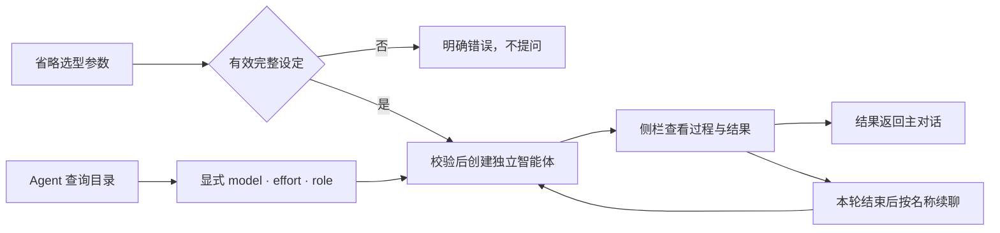

# 使用细节与 CLI 说明

[简体中文](usage-details.md) | [English](usage-details.en.md) · [返回 README](../README.md)

本文保存 README 精简前（v0.8.2）的完整说明：各 CLI 的账号、路径与模型规则，安装细节，运行中消息与兼容路径，以及开发验证命令。章节编号沿用原 README。逐版本变更见 [历史版本与详细配置](version-notes.md)，实际验收见 [任务与实际验证](tasks.md)。

## 4. 环境与 CLI 支持

### 4.1 环境要求

| 项目 | 要求 |
| --- | --- |
| 操作系统 | **macOS / Windows**；外部 CLI 需安装对应系统的原生版本 |
| 宿主 | **DeepSeek Harness**；按所需接口能力检查，不因宿主版本号直接拒绝加载。实际验收版本记录在 Release；随包原生视图资源按对应官方源码单独构建和校验 |
| Node.js | **≥ 22.19.0** |
| 外部 CLI | 按需安装，并准备该 CLI 自己的登录或 API 配置；OMP 的 npm 版本需 Bun ≥ 1.3.14 |
| 安装命令 | 在 Desktop 菜单“管理 dsh 命令…”中启用 `dsh`，macOS 与 Windows 使用相同命令 |
| 源码开发 | pnpm **11.25.0**，以仓库锁文件为准 |

### 4.2 支持范围与验证边界

插件使用各 CLI 原生的保护和权限模式，不再附加操作系统进程沙箱。Windows x64 此前已通过运行层和 11 个 CLI 的账号来源测试，并实测 Codex/Pi/OMP 启动及 Pi SDK 元数据；这些历史结果不代表本次新协议已在 Windows 实机验收。下表保留历史版本与模型调用记录。模型列表只展示当前 CLI 自身账号可用的选项。

| CLI | 历史核验版本 | 历史验证范围 |
| --- | --- | --- |
| Antigravity | 1.2.16 | 首轮、续聊与停止已有真实验收 |
| Codex | 0.160.0 | 真实首轮与同会话续聊通过 |
| Claude Code | 2.1.176 | 真实首轮与续聊通过；测试环境的 `sonnet` 映射到 GLM |
| Kimi Code | 2.1.1 | 原生令牌状态及登录管理入口已修复；此前 0.42.0 真实请求被订阅权限 403 阻止，本轮未重新生成 |
| 官方 MiMo Code | 0.1.15 | 真实首轮与续聊通过 |
| ZCode | 0.16.9 | 原生登录、headless 与会话协议已接入；详见专项记录 |
| Grok Build | 1.0.0 | 自身登录、官方 Build 访问许可和模型目录分别核对；目录可读不等于有调用权限，真实生成未验收 |
| OMP | 16.4.4 | 原生登录菜单及自身日志写权限已修复；RPC 接入，历史智谱 Coding CN GLM-5.3-Flash 已实测 |
| Pi | 1.0.2 / 1.0.4 / 1.1.0 | 原生安装身份及 SDK/RPC 按版本核验；1.0.2 的智谱 Coding CN GLM-5.3-Flash 曾实测，1.0.4 仅只读/离线核验；1.1.0 在 Windows 通过无凭据 SDK/RPC、原生登录菜单显示及终止清理验证，尚未完成真实登录与模型调用 |
| Hermes Agent | 当前安装 checkout 6c80c32734 | 独立自身账号目录、原生登录菜单及 Nous 自身账号目录已验收；只读确认 10 个免费模型，真实生成与续聊未验收 |
| OpenCode | 1.18.21 | 原生目录与 JSONL 接入；智谱模型已实测，免费 MiMo 请求曾返回 403 |
| Qoder CLI | 1.1.73 | v0.8.1 新增原生 ACP；真实账号元数据及 17 项动态模型目录已核验；真实模型任务、工具产物、恢复、运行中取消及 Windows 尚未验收 |
| Qoder CN CLI | 1.1.74 | Windows 自身账号及 15 项动态模型目录已核验；Qwen3.8-Flash / low 的生成、文件工具、同会话续聊与运行中取消通过；另在正常新对话中实际派遣并完成原生子会话界面检查，其他模型和 Mac 运行时未实测 |

v0.7.10 的新任务改用各 CLI 原生双向协议：Codex app-server、Claude/Antigravity stream-json 输入输出、Kimi/Grok ACP、ZCode app-server、OpenCode/MiMo HTTP+SSE、Hermes Runs API；Pi/OMP 保持原生 RPC。旧任务仍按创建时的通路恢复会话，不静默改换模型或协议。上表保留历史执行证据，新通路的实际验证范围见 [原生通信说明](native-protocols.md) 与 [验收记录](tasks.md)。

v0.8.1 新增 **Qoder CLI**，通过官方 `qoder --acp` 接入同一原生侧栏，模型和思考强度读取其结构化目录并在发送前确认。当前协议仅开放“允许编辑”，未宣告只读规划模式；规划任务会在发送前拒绝。Qoder 按积分计费，输入框底部与回复功能条均显示对应本轮积分，详情标题为「积分用量」；积分缺失时保持未知，不在该模块混入 Token 单位。回复用量的提供方／模型按该轮已确认来源显示为 `CLI/提供方/模型`，例如 `omp/zhipu-coding-plan/glm-5.3-flash`；提供方未公开时明确标为未公开，不展示内部 Worker 路由。所属原生会话若提供上下文比例，则独立展示该比例。同轮原生运行配置或日志能核实实际窗口时，补充容量及带估算标记的占用数量，否则数量和容量仍为未知。积分按本轮原生请求去重，不从积分反推 token；缓存和分类没有来源时仍保持未知。Windows 兼容原生 Administrators 所有权和继承只读 ACL，仍拒绝不可信写权限，不修改用户文件权限。轮次和步骤表示宿主子会话记录，不等于 Qoder 内部请求次数。协议及探针范围见 [Qoder 原生协议核验](qoder-protocol.md)。

MiMo 指 [XiaomiMiMo/MiMo-Code](https://github.com/XiaomiMiMo/MiMo-Code)。Hermes Agent 替代的是旧的外部 Harness CLI 入口，**DeepSeek Harness 宿主仍是插件的运行基础**。

MiMo 短时间重复加载模型能力时复用有界内存缓存，减少 Windows 上反复启动 CLI 的等待。首次加载仍需查询原生 CLI；账号、配置、项目或程序变化使缓存失效，每次派遣仍核对当前账号授权。

设置页最多同时执行两项预加载任务，每项按账号、模型目录顺序读取，当前选中 CLI 优先；切换只调整待排顺序。目录查询内部仍遵循各 CLI 的原生进程与清理规则，并非所有底层子进程总数的承诺。关闭或禁用取消未完成读取，已经完成的结果保留，底层进程清理由 Host 管理。

Kimi 已核验的 managed OAuth 模型能力和 Claude 的命令参数能力也可短时复用；每次实际重新识别目录时仍核对当前凭据、有效期和远端权限，不缓存远端额度。Windows 后台查询及嵌入式账号终端的启动器隐藏额外控制台窗口。

Windows 的设置首次加载、刷新与模型／强度自动保存继续执行必要的账号和目录校验。已核验的 Codex npm 0.162.1 启动脚本在后台直接使用同安装的原生 CLI，避免脚本内部再次启动程序时弹出终端；保留原安装路径、包管理器环境和进程清理。其他脚本版本保留原启动方式，具体窗口验证范围见 [实际验证记录](tasks.md)。

Windows 的 Antigravity 后台模型查询及任务使用官方环境开关关闭本次进程的自动更新，避免更新程序另开终端。该开关只作用于插件后台子进程，用户正常打开的 Antigravity 终端仍按原方式更新；macOS 行为不变。

成功且进程退出已确认的扩展 CLI 模型查询会自动删除本次临时目录和原生解压缓存；失败或清理未确认时保留现场，不删除原始账号文件。

专项记录：[ZCode](zcode-probe.md) · [Grok](grok-probe.md) · [Pi / OMP](pi-omp-probe.md) · [Hermes](hermes-probe.md) · [OpenCode](opencode-probe.md) · [Qoder](qoder-protocol.md) · [Qoder CN](qodercn-protocol.md)

### Qoder CLI 安装与登录

按 [Qoder 官方安装说明](https://docs.qoder.com/cli/installation) 安装 CLI。macOS / Linux 的推荐入口为：

```sh
curl -fsSL https://qoder.com/install | bash
```

Windows PowerShell 使用：

```powershell
irm https://qoder.com/install.ps1 | iex
```

已有 Node.js 环境也可使用官方保留的 npm 兼容入口 `npm install -g @qoder-ai/qodercli`。完成后运行 `qoder --version` 和 `qoder login`，按原生浏览器流程登录；CLI 也支持自身的 `QODER_PERSONAL_ACCESS_TOKEN`。不要把令牌写入聊天或仓库。安装和登录由用户按需完成，本次接入没有自动安装或登录 Qoder。

Qoder 中国版使用独立入口 **Qoder CN CLI**（`cli=qodercn`），默认用户目录 `~/.qoder-cn`、登录变量 `QODERCN_PERSONAL_ACCESS_TOKEN`，不读取国际版账号或偏好。安装与原生登录命令见 [中国版官方说明](https://docs.qoder.cn/cli/installation)，npm 兼容包为 `@qodercn-ai/qoderclicn`。Windows 自动识别 `~/.qoder-cn/bin/qoderclicn/qoderclicn.exe`，并核验同品牌 npm 入口；无需借用国际版路径。两版模型和强度均动态读取，不能照搬对方档位。用户泛称“调用 Qoder”时，仅安装一版则使用该版；两版均安装时返回歧义候选，Agent 必须显式传 `cli=qoder国际版` 或 `cli=qodercn`，不弹版本询问卡。明确说“Qoder 国际版”或“Qoder 中国版 / qodercn”时固定对应版本。旧会话保持原品牌，不自动迁移。

Windows 各 CLI 共用有界路径发现：显式路径优先，复用常见用户 bin/npm/Bun/Scoop/pnpm 目录，并在进程 PATH 缺失后读取最新用户和机器 PATH。专属目录、npm 包名和原生程序身份仍按 CLI 声明核验；自定义便携位置既未加入 PATH 又无安装登记时仍需设置路径。不扫描任意磁盘、不猜最新版本、不执行桌面 GUI。详见 [中国版协议与隔离](qodercn-protocol.md)。

在插件“CLI 连接”选择 Qoder、刷新模型并明确选型后再派遣。初始化握手、登录状态和模型目录是独立检查；握手成功不代表模型调用已通过。账号来源及真实验收限制见 [协议核验](qoder-protocol.md) 与 [实际验证记录](tasks.md)。

Windows 会自动检查官方原生 `~/.qoder/bin/qodercli/qodercli.exe` 和当前用户 npm 安装入口，即使 Desktop 尚未继承安装后的 PATH。PATH 发现优先采用独立 `qodercli`，缺失时兼容旧 `qoder` CLI 别名；npm 入口按官方包声明静态核验。已有手动路径继续优先，损坏或权限不足时保留错误，可在高级设置检查路径。

Qoder 设置中的单次目录加载会合并账号与模型查询，减少重复启动；实际重新读取目录时仍核对当前账号，显式刷新强制重新查询；仅重开已完成预热的设置页面复用展示结果，不重复执行原生查询。账号和模型目录通过同一已安装 CLI 的官方元数据接口读取；缓存和必要配置副本放入临时私有目录，查询结束后清理，不由插件解密浏览器账号文件。原生登录和 PAT 分别处理，目录仅列出当前启用的模型。需要原生迁移的旧项目设置，以及尚未绑定的 `.env` 认证或运行控制声明，会在查询前明确拒绝。macOS 已核验真实账号与模型目录；PAT、真实模型任务和其他平台的完整调用仍待验收。

### Claude Code 与 CC Switch

macOS 与 Windows 均读取 Claude Code 自身的当前配置。关闭 CC Switch 路由后，可在插件账号区登录 Claude 官方账号；打开路由后，刷新 Claude 模型列表并选择路由模型。登录和退出官方账号保留 CC Switch 配置。

支持 Fable 等原生模型映射及 `[1m]` 上下文后缀，执行时保留准确模型标识。网关未提供模型目录时，仅显示该路由明确配置的模型，并说明远端可用性尚未核验；认证拒绝或查询异常不会切换官方账号。切换路由或映射后重新选择模型，旧任务若来源变更需新建。

## 5. 安装与更新

### 5.1 一行安装

```sh
dsh plugin --profile desktop add dsh-cliworker-now@latest
```

v0.8.1 安装包同时携带原生子对话必需的四包界面扩展；由官方 bundle 层使用包内相对路径接入，无需手工指定路径或构建宿主，也不改写应用文件。安装、升级或卸载前结束任务并完整退出 Harness，完成后冷启动。卸载本插件会撤回该 bundle 层，恢复官方界面入口。

已有自定义界面覆盖、禁用项或带旧模块来源断言的设置可能冲突。启动预检只读核对来源与摘要，不能安全保留时明确拒绝，不自动删除或迁移用户配置；请保留备份后处理冲突，或卸载本插件恢复。扩展的官方源码、补丁、逐文件摘要和许可随包保存在 [runtime-host](../runtime-host/README.md)。当前资源基于官方 0.2.1-rc.2，实际兼容性按接口能力检查，已验证版本和平台范围以 Release 为准。

<details>
<summary>Web、源码安装与更新</summary>

使用 Web profile 时：

```sh
dsh plugin --profile web add dsh-cliworker-now@latest
```

安装或更新前先结束活动任务并完整退出 Harness，完成后重新打开。`@latest` 按安装器当前规则解析 npm 最新版本；启动 Harness 本身不会自动更新插件。pnpm 11 默认等待新版本发布满 24 小时，期间命令可能成功退出但仍安装旧版；请核对实际安装版本，等待后重试，或使用下方已校验的本版预构建包。npm 包已预构建，无需手动解压或编译。也可以在插件页“添加插件”中输入 `dsh-cliworker-now@latest`。

可运行 `dsh plugin --profile desktop ls dsh-cliworker-now --depth=0` 核对实际安装版本。

GitHub Release 备用安装：

```sh
dsh plugin --profile desktop add https://github.com/SuperWheel/dsh-cliworker-now/releases/download/v0.7.9/dsh-cliworker-now-0.7.9.tgz
```

**GitHub 源码安装**

源码构建需要 Node.js ≥ 22.19，以及可从 `PATH` 直接调用的 pnpm；项目固定使用 pnpm 11.25.0。安装前先运行 `pnpm --version` 确认命令可用。若尚未安装 pnpm，请参考[官方安装文档](https://pnpm.io/installation)准备该版本；Harness 内置安装器不保证为源码构建提供可调用的 pnpm。

需要直接从 GitHub 构建时，可使用：

```sh
dsh plugin --profile desktop add github:SuperWheel/dsh-cliworker-now
```

Web profile 使用：

```sh
dsh plugin --profile web add github:SuperWheel/dsh-cliworker-now
```

不带 `#` 时使用仓库默认分支。已有的 `v0.7.8` Tag 早于本入口，不能用作这条源码安装命令的引用。要固定源码，将 `<完整提交SHA>` 替换为包含源码构建入口的完整提交 SHA：

```sh
dsh plugin --profile desktop add "github:SuperWheel/dsh-cliworker-now#<完整提交SHA>"
```

此方式需要下载构建依赖并编译，通常比预构建包慢；默认分支源码不等同于已冻结的 npm 稳定包。重复执行安装命令不保证自动追踪最新 HEAD，请核对实际解析的提交。

安装或更新若提示 `ERR_PNPM_GIT_DEP_PREPARE_NOT_ALLOWED` 或 `ERR_PNPM_IGNORED_BUILDS`，需要授权构建。按 dsh 输出找到对应 profile 的 `pnpm-workspace.yaml`，把报错给出的确切键新增到已有 `allowBuilds` 中并设为 `true`；保留所有原有配置和其他规则，再重试同一安装命令。若尚无 `allowBuilds`，只新增该映射，不替换整个文件。更新到其他提交时，可能需要按新提示追加授权。

Windows 源码构建还可能受缓存或临时目录路径长度影响；若在依赖安装阶段失败，可缩短相关路径后重试，或改用上面的预构建安装方式。

从源码开发：

```sh
git clone https://github.com/SuperWheel/dsh-cliworker-now.git
cd dsh-cliworker-now
pnpm install --frozen-lockfile
pnpm --config.verifyDepsBeforeRun=false build
dsh plugin --profile desktop add .
```

上述本地目录安装会链接源码目录，因此该目录需要保留。卸载使用：

```sh
dsh plugin --profile desktop remove dsh-cliworker-now
```

卸载保留本机账号、历史会话和偏好。每个 Release 提供 `SHA256SUMS.txt` 校验文件。

</details>

v0.8.1 原生会话候选的最新协议和数据覆盖见 [全 CLI 复查](cli-native-data-audit.md)：新建 Worker 使用原生双向协议，历史 Worker 保持原协议；已知用量由完整 DSH 视图显示，缺少上游数据时不伪造。候选与实际 Desktop 安装状态以验收记录为准。

## 6. 使用方法

CLI 返回公开思考时，生成中可查看原生摘要预览，结束后展开“已完成，用时…”的原生过程，再点击其中的“思考记录”查看各段内容；关闭重开仍保留。已接入的 CLI 共用此入口，实际内容取决于原生协议和模型是否返回。Codex 新轮会请求公开摘要，已返回的公开增量实时进入原生过程，停止或失败后保留已公开内容；旧轮没有摘要时不会补造。详见 [公开过程说明](public-process.md)。

### 6.1 首次派遣

在已选工作目录的 Harness 主对话里，明确说出要使用的 CLI，例如：

> 用 Codex 检查这个项目的登录错误处理，把这个智能体命名为“代码审查员”。

也可以使用简称或别名（本地 v0.6.7 起）：

> 调用 agy cli 帮我审查这个项目。
>
> 调用 glm cli 帮我检查这段代码。

`agy` 对应 **Antigravity**，`glm / zhipu / 智谱` 对应 **ZCode**，`harmes` 对应 **Hermes Agent**。插件会为当前明确调用提供路由提示，并在派遣工具里统一解析名称；支持 `Antigravity（agy）CLI` 这样的同名别名，重复指定同一 CLI 仍视为一个目标。较长名称的轻微拼写误差只有唯一候选时才接受。未知名称或多个目标返回简短错误和候选，不自动派遣，普通模型讨论、否定调用和引用示例不会触发路由提示。是否调用工具仍由 Harness 主模型决定；如果模型忽略请求，可明确说“使用 CLI Worker 插件调用 agy CLI”。

CLI Worker 由 Agent 通过调用参数指定选型，不直接向用户弹模型、强度、角色或沿用问题卡：

1. 用 `cliworker_models({cli})` 查询精确模型 ID、实际支持的 `efforts`。
2. 可用 `cliworker_roles()` 查询预设 ID、名称及摘要；在 `cliworker_start` 传 `role=<精确ID>`，或 `role="none"` 明确不使用预设。
3. 在 `cliworker_start` 传 `cli`、`title`、`prompt`、`model`、`effort` 和可选 `role`。首次显式模型但没有有效完整旧设定且省略角色，表示不使用预设。

省略选型参数时优先复用当前主对话完整设定，再复用同项目同 CLI 有效完整设定；不再询问是否沿用。旧版只有模型/强度的偏好不是完整设定，缺 `model` 返回 `MODEL_REQUIRED`；模型有多个强度且没有可复用值或原生 default 时返回 `EFFORT_REQUIRED`，由 Agent 查询并补参，不猜模型/强度、不产生任务或半套设定。当前主对话失效设定不会悄悄换用另一个项目默认。首次参数选择、复用和启动仍重新检查当前自身账号、模型、权限与取消；登录和权限审批不是选型问题卡，门禁保持。

每次工具调用必须显式传入 `cli`（Antigravity 也一样）；漏传只返回参数错误，不采用上次调用或默认 CLI。当前明确调用携带参数化派遣指引，通用提问工具保持不变。

各 CLI 只使用自身原生登录，或在该 CLI 自己的配置／私有 `.env` 中单独设置的 API Key。模型与强度按“本 CLI 支持”与“当前自身账号可用范围”筛选；Claude 自身显式网关配置按第 4 节的专门规则展示候选，并说明远端可用性未核验。公共目录、旧缓存、固定别名和匿名免费模型不能单独成为可选依据；未满足上述证据条件时显示空列表及简短原因。账号范围使用只读模型查询，不通过生成请求试探权限。

设置、模型菜单和任务卡片只显示模型名称，删除服务商、组织路径前缀及括号附注；同一原生模型去重，不同原生模型同名时仍保留独立选项，保存和执行使用完整路由 ID。新选择优先有明确证据且可用的免费额度，缺省零成本和价格未知不当免费。有效的既有选择保持不变，首次使用由 Agent 按任务授权提供精确选型参数，免费路由失败也不会自动转为付费请求。

OMP（Oh My Pi）与 Pi Coding Agent 是两个独立 CLI；安装、账号、模型和会话各自管理，即使使用相同模型也不能互换。插件核验实际执行程序身份；Pi 优先使用已核验的原生安装，不暗中切换到另一旧版。

Windows 也能发现当前用户注册的官方 Codex 应用包内 CLI 和官方 npm 固定入口，以及 Hermes 的官方安装目录；只有安装痕迹而没有可执行文件时会提示完成安装。Windows 支持已核验的 Pi 官方固定启动器，以及 OpenCode npm 包声明的原生程序入口。插件静态解析并校验安装身份；无法确认或已损坏的入口会提示检查安装。Pi 其他版本需先核验 SDK/RPC 和原生菜单后接入。

OMP、Pi、Hermes 和 OpenCode 的账号行按自身认证显示服务商及方式。有账号登录时简写为“OpenAI账号登录”等，完整安全身份及其他 API 认证保留在悬浮详情；仅 API 时显示“zai.cn API 登录”等。有效认证不会统一降成“已配置”。只有配置声明、缺失或失效凭据保留对应灰/红状态，模型权限仍单独核对。

OMP、Pi 和 Hermes 的“退出”使用统一按钮并打开各自原生退出菜单。多个自身账号目录先选择来源；操作针对所选真实来源，其他来源保留。Pi/OMP 原生退出不能删除的 `.env` 或模型配置内 API，需在原配置中管理。Hermes 原生写入的停用来源会同步约束登录、模型和调用，不从保留的配置值恢复账号。

Windows 的 ZCode 和 OpenCode 还会通过已知默认目录、当前用户及系统安装登记、已运行的对应程序位置，以及开始菜单和桌面快捷方式发现自定义安装目录，支持非系统盘、中文和空格路径。ZCode 核验 `resources/glm/zcode.cjs` 及配套 provider 文件；OpenCode 桌面安装采用实际存在的独立 `opencode-cli.exe`，桌面版本未附 CLI 时会明确提示。已有显式路径、ZCode 已部署运行时和正常 PATH 入口优先；多个不同可用安装需通过 `zcodeExecutable` / `opencodeExecutable` 指定。`DisplayIcon` 是安装注册表中的程序/图标文件路径，不要求桌面上存在图标或快捷方式。任意位置的便携目录若没有安装登记、快捷方式或 PATH，且程序未运行，仍需显式配置；发现安装位置不代表已登录或模型可用。

Desktop 中按磁盘实际文件识别安装，兼容 Electron 对 ASAR 归档的处理；OpenCode 的正常 npm CLI 不要求旁侧存在桌面归档。无需重装 CLI 或重新配置账号。

每个 CLI 设置页的独立“高级设置”默认折叠，通过右侧箭头展开后可管理 CLI 路径。首次成功识别会将路径保存到本机，后续优先复用；也可输入完整文件路径并点击“刷新”，同步更新 CLI 状态，或“恢复自动识别”。这项设置跨项目共用，但按机器和操作系统隔离。手动路径优先于部署配置，部署配置优先于自动记录；自动记录文件消失后重新识别，手动路径失效则保留并提示，不会静默换用另一个安装。请填写 CLI 文件路径，不要填写桌面 GUI、目录、命令参数或外层引号。

设置页的标题、标签、留白、分隔线和控件遵循[统一设计规范](settings-ui-design.md)，后续扩展复用同一套参数。

ZCode 登录前可选择“中国智谱 BigModel”或“海外 Z.AI”，Mac 和 Windows 使用同一入口；只启动所选来源的官方授权。完整 CLI 的 `login [zai|bigmodel]` 能力与部分 Desktop 内置旧 CLI 不同，仅有 Z.AI 的旧版本选择 BigModel 时会提示升级，不会改开海外页面。插件优先使用 `~/.local/share/cliworker-now/runtimes/zcode/cli/zcode.cjs` 中已部署的完整 CLI，显式配置的执行路径优先级更高；Windows 安装需对应平台的原生依赖。升级 CLI 不会自动迁移 ZCode Desktop 账号，登录继续写入插件独立的 ZCode 账号目录。

Windows 的原生授权网址会完整打开一次，也可在终端中点击或选择复制；网页打开不代表授权已完成，需按官方网页提示完成登录。

账号发现和执行绑定同一来源；设置页保存选型、新任务、排队出队和续聊都会重新核对账号、模型与强度；子对话改选先按保存目录记录偏好，实际发送时再核验。换号或退出会阻止旧任务启动，历史任务换号后需新建任务；升级前未记录账号绑定的历史任务也需新建，原对话保留。插件不读取其他 CLI 的凭据，也不继承 Harness API 凭据；旧 `zaiCredentialRef` 配置兼容读取但不生效。旧派生认证快照会按当前自身来源重建，原生账号、历史会话和偏好保留；失效偏好需重新选择。

Antigravity 使用自身原生登录和实时 `agy models` 目录，只展示原生返回的模型及强度变体。非 Windows 的文件认证统一读取当前 home 下的 `~/.gemini/antigravity-cli/antigravity-oauth-token`，状态、模型预检和任务账号绑定使用同一来源；不复制或迁移 token，也不回退旧的 `~/.gemini/jetski-standalone-oauth-token`，避免旧账号与 CLI 实际来源不一致。依赖旧文件或系统密钥环的其他 CLI 版本不能由此推定兼容。Windows 使用原生 Credential Manager 中当前交互式用户的账号，仅返回安全身份摘要。账号读取先完成，模型查询的等待或失败不会把已登录账号改为未登录。重复的在途账号读取会合并，后续刷新与执行授权仍读取当前账号。本地材料可读不代表远端模型授权已通过。

Claude 会显示当前来源：自身配置的本地代理可达时使用代理，代理关闭时使用原生官方账号。代理认证或模型查询失败会明确报错，不自动换号。官方登录／退出只作用于官方账号，保留代理设置；任务启动前固定来源，不在运行中切换。官方 OAuth 模型需同时通过原生身份、模型能力和剩余额度核验；缺少证据时不放行。

当前账号范围边界：Kimi 原生 managed OAuth 使用自身模型别名、认证目录和可确认的套餐额度；额度为空、未知或耗尽时提示检查账号。其他未核验的 Kimi OAuth 模式及 OpenCode v1 OAuth 暂不开放派遣。Claude 自身设置中的 API Key／Bearer Token、Kimi 自身 API 配置、MiMo 原生网页登录写入的自身 API 认证，以及可核对的本地配置，按账号列表筛选；保留网页登录附带的官方服务地址。Codex 支持已核验的官方文件账号路径，keyring 或自定义路由缺少范围证据时不放行。MiMo 目前只接受可核验的本地配置，文件／环境插值和远程组织配置需先移除。上述 OpenCode 可执行范围是 v1；v1 原生 OAuth 写回缺少账号版本保护，暂只开放自身 API 配置。v2 不读取旧 auth.json 或创建隔离 OPENCODE_DB：仅使用现有受信 Linux 服务，核验私有记录、进程/PID/版本与固定回环来源，再开放显式 `read_only` 纯文本任务。只接受当前首个 key/oauth credential 来源，不把环境、外部或 needs_auth 来源当授权；状态“已配置”和原生 enabled 模型不等于远端访问已验证。精确 provider/id/variant、原生首项默认 agent 与全工具 DENY 规则固定在插件自有会话中，不复制旧 ALLOW；不提供文件工具、编辑、shell、MCP、附件、分支、实时引导或会话内模型切换。模型变化需新任务，不能将 v1 或用户原生历史迁为 v2 owned 会话。

v2 每轮只提交一次耐久 input ID；ACK 丢失先核对同 ID 的 inbox、用户消息和耐久日志，取消后也不重发。日志只显示关联本轮的最终文本分段，不伪装实时 delta 或补造成本/令牌。未知的异步准入可能在一次空闲检查之后晚到：只有先证明该输入已准入，后续同 PID wait、active/inbox 与日志核对才能确认停止。已知准入但缺模型终态或最终正文时，模型结果仍不确定，不自动续跑；无可信清理证据、桥被 kill、PID 更换或未确认策略则持久隔离。明确停止已隔离任务只清理原服务/marker 的自身输入，不要求当前账号仍相同，不重发、不杀共享服务、不删历史。没有远端会话的 pre-spawn 不确定记录、GET 404 或新服务的空闲不自动解除隔离，仍需人工核查。此阶段只证明受控纯文本前台流程，不保证任意原生插件或 detached OS 作业结束。

正常服务重启不破坏已完成会话的稳定 credential 来源绑定；每轮仍另固定服务 epoch。外部原生界面若向 owned 会话插入或修改历史，即便现已空闲也拒绝继续使用该历史，不删除外来内容。真实 DSH 子会话仍创建并投影回复，但不会分配工具/MCP lease。账号终端仅由用户主动打开，不注入登录/退出、不自动启动服务、不读取或复制凭据数据库；服务密码只走 Host 私有环境和回环认证，不进入 Gateway、请求文件或 ledger。当前验收为实际 Host/bridge/DSH 子会话对合成 v2 服务；真实 OpenCode 服务、模型、GUI 与非 Linux 未验收。

Codex 仅在本次可核验检查明确拒绝时分别提示额度耗尽或认证不可用，保留现有账号和项目偏好，不把原生模型能力当成当前可调用权限。本轮新增诊断区分可用范围未知、原因未确认的拒绝、真实空目录、原生能力无交集和来源变化；未知不等于已登出或无额度。曾显示模型也不能绕过下一次fresh准入检查，查询期间换来源会拒绝，同主体正常token轮换不当换号；不会借用旧目录、自动重试或换号。源码、已部署和实机范围分别见[验收记录](tasks.md)。

Kimi 已有有效或可续期的自身原生登录时显示“已登录”及可确认的简短账号 ID；原生未保存邮箱或昵称时不编造，点击“管理登录”打开原生终端；切换账号由用户输入 `/logout` 后再输入 `/login`。账号终端使用独立空目录，不加载用户项目 MCP；原生若显示 Trust 提示，由用户自行确认。只有 managed OAuth 引用而没有对应令牌时才显示未登录，不会自动退出原账号。自身 API 配置则保持“已配置”，不要求另有 OAuth 令牌：Kimi 2.2 的内联密钥、对应提供商类型的私有 env、明确的 apiKeyEnv 引用按同一原生顺序解析。显式引用缺值显示配置未就绪，冲突或未支持的来源不用于绑定，不能回退另一把密钥。任务仅传选定模型声明的必要环境值，账号终端仅传自身明确引用；不复制整个宿主环境，也不把值写入 argv、公开记录或桥请求。KIMI_MODEL_* 全局覆盖暂不支持。此次当前本地 API 配置读取成功，不代表已复现用户此前的界面误报或确认远端调用权限。

Hermes 首次明确打开登录设置后使用插件内独立原生账号目录，自动导入关闭，状态、模型、任务统一绑定该目录；之后退出不会回退到全局旧账号。原全局账号和历史保留，Host 不把其他 CLI 导入凭据作为自身登录证据，不注入 Harness 认证；原生进程按自身权限运行。现有官方安装的已选依赖环境可直接复用，账号操作不触发重新安装。

Hermes 的 Nous 登录按当前原生授权识别，模型来自该账号认证的官方目录及访问权限；无付费权限时仅开放明确免费的可用模型。Mac 与 Windows 共用自动续期：短期访问令牌临近过期或已过期时，使用同一账号的原生刷新凭据续期，健康令牌不额外启动进程。临时网络问题可刷新重试，只有刷新凭据缺失或明确失效才要求重新登录。续期不调用模型、不切换账号，也不清除额度或冷却限制；不会用旧快照恢复已退出的账号。

Grok 先核对自身官方 Build 访问门禁，再读取认证模型目录并匹配原生模型及强度能力；登录成功或目录 HTTP 200 均不能单独证明调用权限。是否有付费订阅也不能代替服务端门禁结果；未知或拒绝时保持空列表和简短原因，不通过生成请求试探。



### 6.2 查看、停止与继续

- 点击任务卡片在右侧 CLI Worker 栏打开原生对话正文与输入栏，顶部保留原 Worker 返回、标题和任务操作，主页面保持原位置。返回侧栏总览不会清空原生未发送草稿。
- 总览的搜索和状态筛选固定在上方，任务列表独立滚动，首卡顶部完整显示；不显示匹配说明或清除筛选文字。异常右侧的垃圾桶按钮可查看已删除对话，再次点击或选择任一状态筛选均可返回；查看已删除时四筛选呈灰色，垃圾桶为深红底白图标。
- 右键任务卡片可修改聊天标题、智能体名称或删除；聚焦卡片打开按钮后也可按 `Shift+F10` 或菜单键操作。卡片不显示省略号按钮，右侧箭头在整行居中；已删除的空闲任务及其历史可以恢复。
- 默认名称采用 `agy-1`、`codex-1` 等短名称，旧默认名兼容寻址；名称按钮加宽但文字起点保持，名称与模型到分隔线的文字距离相等，点击后文字显示「已复制」，移开鼠标约一秒后恢复。
- 思考强度统一显示为 `Low`、`High` 等，保存和执行仍使用 CLI 原生值。
- 缺少账号记录的旧任务保留历史；标题下与原生新会话按钮等高的提示条提供「新建对话」，可按原模型、强度和角色使用当前自身账号新开。因正常停止而尚未建立原生会话的任务允许重新发送，并提示将建立新的 CLI 会话；其他缺少会话或账号的情况仍按原有规则处理。
- v0.8.1 的完整原生对话通过已授权宿主扩展选择主对话按钮呈现，空输入运行时由原生主按钮显示停止，输入内容后按原生发送规则处理；真实子 Agent 身份和 Inbox 保留。停止仍等待受管进程清理，正常停止不报失败，已有 CLI 会话继续沿用原上下文。
- v0.8.1 发送、排队、编辑/移除、菜单和快捷键直接使用原生 Session/Inbox。发送结果尚未确认时先核对记录，不自动重发；旧兼容队列不自动导入原生队列。
- 子对话使用与 Harness 主聊天一致的返回最新圆形按钮和历史功能条淡入淡出；最新消息功能条保持可见，历史条在悬停或键盘聚焦时出现。
- 子对话输入框按 Enter 发送、Shift+Enter 换行，支持 Ctrl/Cmd+Enter，中文输入法确认不会误发送。
- 以下自定义运行中发送规则仅用于旧 Worker 兼容路径，v0.8.1 原生子会话使用 DSH Inbox 规则。高级设置的「运行中发送」可选择「引导、插队、排队」：引导交给 CLI 在当前运行中处理；插队先停止当前轮，确认进程退出后优先发送；排队在当前轮正常完成后依次续聊。Codex、Hermes、Pi、OMP 的已接通原生通路默认引导，其余默认排队。旧通路保留原会话，未接通引导时在该对话显示原因。偏好按项目与 CLI 保存，本次按能力一次性更新现有项目的发送方式，后续手动选择继续保留。引导使用独立的当前运行输入通路，不进入排队、不受暂停队列影响；当前轮未就绪或已结束时保留输入并说明原因，不等下一轮自动发送。接收回执不代表模型已执行，能力与限制见 [原生引导说明](running-message-protocol.md)。
- 历史兼容路径中，点击发送时立即固定消息编号、方式及显示位置。刚提交、准备和停止清理都占用会话，连续发送不会因「已完成」旧状态把排队消息误显示成气泡；排队消息实际启动后才转换一次。卡片插队立即显示同一条用户消息并平滑退出，连续插队只启动最新的未执行请求，已开始的请求先完成停止清理；旧气泡保留，不附加例行取消文字。真实失败和结果不明保留核查入口，迟到回执不能恢复旧卡片。
- 历史兼容路径的待发送区可以折叠并保留数量，切换或关闭侧栏不改变消息顺序。主动停止、失败和结果不明会暂停关联未发送消息；Host 重启恢复内容并暂停自动执行。停止后明确开始的新一轮及其新增队列可以继续，旧暂停卡片仍需点击「继续发送」。发送方式变更只影响后续提交；存在待发送卡片（包括暂停项）时，模型与强度需先发送或取消这些卡片才能修改，避免改变旧消息选型。用户气泡只按正文计算宽度，时间、复制和反馈独立布局，正文空格与换行保持不变。
- 本轮结束后，也可在主对话中说：**“让代码审查员继续检查测试覆盖。”**
- 按名称续聊限定在当前主会话内，复用同一个 CLI 会话；重命名不会清空历史或改变角色。
- 关闭侧栏不会停止后台任务，完成结果仍会回到主对话。

### 6.3 管理角色与 CLI

| 设置入口 | 可以做什么 | 生效范围 |
| --- | --- | --- |
| 智能体设置 | 新增、编辑、删除“名称 / 概述 / 角色提示词”预设 | 当前 Harness profile 共用；已有智能体保留原角色副本 |
| CLI 连接 | 独立开关、刷新状态、登录设置或切换账号、打开原生账号终端 | 对应 CLI；关闭前需先结束其任务与账号终端 |
| 项目默认设置 | 保存默认模型与思考强度 | 当前项目 + 当前 CLI 的新主对话；已确认对话保持原设定 |
| 子对话原生模型菜单 | 从对应 CLI 的真实目录选择当前智能体的模型或强度 | 保存到该 Worker，下一轮发送重新核验；运行或存在任何待发项时锁定 |
| 子对话原生权限 / 规划控件 | 选择该 CLI 实际支持且可写的权限模式 | 由 Host 校验保存；运行、准入、清理及原生或兼容队列存在时锁定 |

子对话优先读取首次派遣保存的模型及强度目录，重复打开不重复查询 CLI；缺少同来源目录时才重新识别。缓存不是执行权限证明，发送时模型失效会明确报错，不静默换用其他模型。插件更换模型时保留原生会话 ID；各 CLI 后台跨模型的上下文处理未在本轮做真实调用验收。

OMP 目录刷新会先更新插件受管目录中的原生模型 registry，再按 OMP 自身当前账号和额度筛选；任务使用同一目录，不因旧缓存缺项持续隐藏新增型号。账号未提供的模型不会硬编码补入，目录可见也不等于真实生成已经验收。

CLI 模型只在对应子对话的模型菜单中选择；主对话模型目录不列出 Worker 内部路由。Grok 若只返回思考 token 数而未公开思考文本，不添加额外提示，也不能据此恢复隐藏文本。

权限控件将 CLI 的“规划”和“允许编辑”分别映射到原生只读、工作区可写预设，保存与执行仍使用该 CLI 的实际模式；不因此增加全访问或自动批准能力。

「工作过程」也会显示受支持 CLI 明确公开的思考摘要与计划，详见 [公开过程支持范围](public-process.md)。未返回公开摘要时保留已有真实过程，不提取隐藏思考或用生成内容填充。

回复按原生消息边界连续显示，过程展开跟随 Harness 的工作详情设置，保留思考、工具调用和正文的实际顺序。工具参数、结果及明确公开的父子调用按原生记录展示；既有 OpenCode 单条回复被拆碎的记录，可在证据完整时只读恢复。

外部 CLI 未报告缓存时，用量组件显示“缓存命中 —”，详情保留已知总量并说明缓存未知；不会以默认零表示真实未命中。Grok、OMP 没有公开过程的轮次不额外插入说明，有公开思考或工具时仍可原生展开。

输入框下的 ContextMeter、StatsPills 及弹层使用真正的 Harness 原生组件。当前窗口、容量、Token 用量和分类分别来自匹配 Worker 的可核查数据。AGY 的 CLI 总量是未缓存输入加输出，不含缓存读取；原生用量弹层按四个独立计费分项汇总，因此会把缓存读取一并计入，并据此显示缓存命中率。已核验的 AGY 输出协议没有独立缓存写入类别，该分项按零规范化。

AGY 上下文来自该 CLI 会话本地原生元数据中的最近一次请求估算与窗口容量。缺失指标按原生规则处理，不以零代替未知值，不拿累计 Token 充当上下文，也不借用父会话或 DSH 显示投影的估算。逐项能力与限制见 [原生界面说明](native-conversation-ui.md) 和 [原生回复与上下文说明](native-inspection.md)。

内置角色：**商业审稿人、逻辑审校员、文风审校员、正文修订师、剧情节点设计师、剧情结构规划师、小说主笔**。更多说明见 [默认角色预设](role-presets.md)。

CLI 连接的状态点含义：

| 状态点 | 含义 |
| --- | --- |
| 灰色 | 未安装、未登录、仅有普通配置或尚未检查；检查中显示加载状态 |
| 红色 | 已知登录失效、配置损坏、读取失败、无效的显式执行路径或已配置后的模型目录失败 |
| 绿色 | 已登录：来自原生状态、可续用登录会话或当前账号的精确凭据绑定 |

未配置 CLI 的空模型目录保持灰色。账号查询结束后再加载模型；刷新账号或结束账号操作会使旧模型清单失效并重新查询。模型刷新中或失败后不能继续选择旧列表，已有项目默认设置保留，恢复后需重新核对。导航与账号摘要使用相同状态规则。账号区仅保留一行状态与必要身份，错误显示简短原因。

### 6.4 目标、规划、反馈与分支

CLI 子会话可使用 Harness 的目标、规划、反馈与分支。不支持的入口仍会显示，但处于禁用状态，悬停时说明当前 CLI 不支持的原因；点击不会发起请求或报错。

这些入口也可在分支打开后的 Harness 原生主视图及子会话侧栏的“+”菜单使用。消息分支按钮只接受正常完成且包含助手消息的轮次；输出文本后失败或中断的轮次保持禁用。

| 功能 | 行为 | 支持范围 |
| --- | --- | --- |
| 目标 | 输入框上方目标栏、“+”菜单或 `/goal` 可设置、编辑、暂停、恢复或清除。目标处于活动状态时，插件会把它以界定块形式放在每一轮发给 CLI 的输入前；子会话里仍显示原消息。目标不会自动发起新一轮，也不使用 CLI 自带的目标续轮功能。 | 全部 CLI |
| 规划 | 沿用原生规划或只读模式映射，可从“+”菜单、权限控件、规划标记或 `/plan` 进入。这些 CLI 不显示规划标记；“+”菜单中的“计划”保留并提示原因。它们只有“允许编辑”一种权限模式，权限控件同样禁用并提示原因。 | Hermes、MiniMax、Qoder、Qoder CN 及旧版 Kimi 通路禁用 |
| 反馈 | 赞、踩和反馈对话框使用 Harness 的反馈服务，仅记录在 Harness；不会发送给 CLI 或厂商，也不会进入模型上下文。 | 全部 CLI |
| 分支 | 消息分支按钮、会话菜单、快捷键或 `/fork` 会调用 CLI 的原生分支，生成新的原生会话，并在同一主会话下新建 Worker 子会话、复制截点之前的历史；原会话可以继续使用。运行中或有排队消息时不能分支。 | 最新完成轮：Codex、Claude Code、Kimi（ACP）、MiMo、ZCode、Pi、OpenCode v1、Qoder、Qoder CN；较早完成轮：仅 Codex。Antigravity、Hermes、Grok、OMP、MiniMax、OpenCode v2 暂不支持 |

Claude Code 的分支会在新分支的第一轮使用 `--resume … --fork-session` 生成新会话 ID。各 CLI 的核实依据见 [设计说明](design.md)。

ZCode 从原生消息列表中的最新助手消息创建包含该轮的分支，纯对话无需工作区检查点。Pi、OpenCode v1、ZCode 的新分支沿用源会话的原生状态目录，重启及再次分支后仍使用同一原生会话存储。

### 6.5 Agent 精确换模与逐轮结果（控制面候选）

- `cliworker_models` 用本父会话精确 Worker 名/ID 查询；也可明确 `cli` 查询本父会话目录，无需先创建 Worker，两种选择器互斥。只读目录不建立首次确认、不是远端额度保证。
- 已有 Worker 换模：目录 → `cliworker_configure` → `cliworker_followup(expected_model=cfg.configuredModel, expected_run_id=cfg.previousRunId)`。保留原生会话、角色与权限，只改这个 Worker。`configuredModel` 是已解析的实际执行 ID，可能包含 native effort variant 后缀，不能拿目录分组 ID 代替。
- 新题首轮即新模型：目录 `cli` 查询 → 直接 `cliworker_start(model=…, effort=…, role=…)`；已有完整设定也可先 `cliworker_configure_conversation` 再 `start(expected_model=cfg.configuredModel)`。configure_conversation 缺设定返回 `FIRST_SELECTION_REQUIRED`，改用 start 参数建立，不弹首次卡、不先跑旧模型空题。只改本父会话/project/CLI setup，项目默认、其他父会话和已有 Worker 不变。start 的 expected_model 只校验；若配置和 start 之间被并发改回旧模型，零 Worker/零 prompt 拒绝。
- UI 与 Worker 配置共用空闲/准备/原生 inbox/暂停队列/清理/固定 transport 门禁；确认设定与首次选择共用同一串行锁。配置与续聊异步目录/账号检查后仍复核权限、source、project、模型及前序 run，最终 Runtime 准入再次检查，不自动 stop/clone/retry。
- `cliworker_result(worker_id, run_id)` 返回该轮公开正文；指定轮不存在不退最新。按 `nextCursor` 作为 `cursor` 继续，页面绑定 Worker/run/事件水位和摘要，追加、新轮、Host 重启不会混页。不混入思考/工具/原始私密数据，也不借旧 lastResult。无 scope 的 SUCCESS 汇总即便以当前片段为前缀也不能补入历史尾文；无 stream 时仅明确可信 run-scoped SUCCESS 可补正文。旧缺证据明确未知，不迁写历史。
- `configuredModel`、`observedModel`、`targetModelVerified`、原始状态、部分性和 `cleanup` 独立；completed 但模型冲突或观察缺失不计作目标模型完成。failed/interrupted/uncertain 的实际公开片段可取回，不是另一个审阅阶段；读取不会自动续跑。新控制回执带 `controlApiVersion: 1`；仅包名/0.8.2相同不能证明已安装新功能，需 bundle hash、工具 schema、实际回执分别核查。
- 原生 child 在异步中间件前捕获 claimed 输入；working-directory/runtime-context 通知不单独准入、不混入正文。按来源而不是文案过滤，真实用户输入相同目录文案仍执行，混合用户/上下文保留真实提交。源码用官方 AgentLoop 合成反例验证，真实旧在线包的额外目录轮次不能算正常任务成功。
- 2026-10-24 父会话旧在线数字身份修复包已验证 Cursor 只读生成、同会话记忆、原生 Read、停止与停止后续聊，不等于新控制面/换模/effort/工具桥/附件/写入/GUI或Windows已过。MiniMax最新真实准备在provider认证/服务覆盖门禁先拒绝，尚未证明本次未登录。Kimi旧GUI未复现、OpenCode v2原生服务/模型未验收等边界保留，其他change的真实任务不因此勾选。

## 7. 权限、数据与常见问题

### 7.1 执行与数据边界

- **按明确选择执行**：CLI 缺失或失败时不会自动换用另一个 CLI；不接管在插件外启动的 CLI。
- **调度有边界**：插件全CLI/父会话共享运行预算默认8，可在“并发与排队”或cliworker_concurrency显式设1–12，非厂商配额；私有明确选择优先初始config。父会话轮转且各自FIFO，前方同目录写任务仍是屏障，运行中不抢占。提高立即drain可运行队列，降低不停止原任务。状态仅报真实容量/写冲突/准备阶段，占位含准备和清理；设置页计数为可刷新快照。坏设置failclosed保留诊断，不静默退默认；queued尚未绑定的新任务为PENDING_ADMISSION而非历史账号缺失。同一 CLI 会话单轮互斥，同一目录的写任务串行。仅支持主对话 → 直接子智能体两层结构，v0.8.1 原生界面按 DSH Inbox 与 CLI 实际引导能力处理运行中消息；历史兼容路径的插队仍须等待进程清理，不并发运行同一会话。不支持递归派遣。
- **宿主容量独立**：DSH active-child政策按managed root pool计槽，插件global12不等于单root可派12，更不是AGY配额。新延期准入候选在typed容量拒绝且无真实child/native、暂态绑定回滚确认后，将同Task/Worker/run原位queued并释放插件槽，显示host-child-capacity，不写failedJob或重复create。事件优先且以2–30秒one-shot补偿无end回滚，等待不消耗执行timeout；取消/权限变化/清理未知不复活或泛重试，不伪造Host闲槽数、不自动改Hostpolicy或旧失败记录。是否已部署与真实任务验收另核。
- **权限按原生能力处理**：Harness 规划模式或只读权限下拒绝启动。允许执行后，支持的 CLI 可按只读任务模式派遣；新 Kimi ACP 任务需确认原生 plan 模式，旧 Kimi 通路、Hermes 和 Qoder 仍拒绝只读派遣。插件不附加 OS 沙箱，各 CLI 的原生权限与工具限制见专项文档。
- **记录保存在本机**：默认位于 `$DSH_HOME/cliworker-now`（通常为 `~/.dsh/cliworker-now`），POSIX 系统中目录权限 `0700`、文件 `0600`。外部 CLI 仍会按自己的服务与配置发送模型请求，不能据此认为任务完全离线。
- **用量有来源**：只展示 CLI 提供或可核查的统计；数据不足时三个原生模块仍保留，以 `—` 和原生详情说明缺失原因，不补零；上下文占用与累计 Token 不是同一指标。估算保留 `~` 标记，详情不展示来源说明行。
- **账号有边界**：原生已登录会话正确显示绿色；自身 API 配置单独标记，模型权限按当前账号筛选。插件不在页面展示 API 密钥；部分 CLI 与原生终端共用账号，退出操作可能同时影响该 CLI 的其他终端。

### 7.2 常见问题

<details>
<summary><strong>已经在终端安装了 CLI，为什么 Desktop 找不到？</strong></summary>

Desktop 不会读取你的 `.zshrc`。插件会识别部分常见安装位置；仍找不到时，在插件配置中设置对应 CLI 的可执行文件绝对路径。可用配置项见 [详细配置与版本说明](version-notes.md)。

</details>

<details>
<summary><strong>模型菜单报错或更新后出现 HTTP 404，怎么办？</strong></summary>

先结束运行中的任务，然后完整退出并重新打开 Harness。只刷新插件列表，可能留下旧 Host 与新 Client，导致接口不一致。重新启动后仍失败，再检查该 CLI 的安装、账号和原生模型目录。

</details>

<details>
<summary><strong>每个 CLI 都需要订阅吗？已登录为什么仍然失败？</strong></summary>

订阅、API 计费和模型权限由各 CLI 的服务商决定。能够打开登录页、读取本地账号或列出模型，不代表对应模型请求一定可用；遇到 403 等错误需核对原生账号权限。

</details>

<details>
<summary><strong>为什么没有思考强度选项或上下文百分比？</strong></summary>

插件只提供 CLI 明确支持的强度。协议 `default` 统一显示为「默认」，仍使用 CLI 的原生默认行为；未提供可核查上下文数据时，原生模块显示 `—`，详情说明缺失原因；不会根据模型名称或累计用量猜测。

</details>

账号、路径和模型刷新按 CLI 隔离：一个 CLI 的认证续期、网络失败、超时或目录错误不阻止其他 CLI。若其元数据进程清理未获确认，仅暂停该 CLI 的进一步查询、账号变更与任务准入，并保留持久保护；不能反复刷新绕过保护。真实任务进程清理失败或旧的无归属保护记录仍会全局阻止派遣。恢复需先核查完整进程退出状态，保留原记录；单纯重开设置不会解除保护。

## 8. 开发与验证

当前开发版本为 **v0.8.1**。v0.7.10 的源码、未提交修改与构建已在迁移前独立备份并逐项校验。本次原生会话与工具桥迁移，以及下一次正式提交前的修复和调整均归入 v0.8.1。修复阶段执行相关最小验收，正式提交 GitHub 前执行 macOS 与 Windows 全量验收；实际结果与验证边界记录在 [实施记录](tasks.md)。

v0.8.1 的当前迁移方案在右侧 CLI Worker 栏运行官方完整 `sidebar.chat.conversation` 视图及其状态逻辑，保留原父级管理页。打开 Worker 不切换主页面。顶部按最新截图保持原 CLI Worker 的返回、Worker 标题和任务操作，不加入父会话面包屑、对话/轨迹页签及主页面页头按钮。子 Agent 关联主对话，按原生 subagent 规则排除在普通会话列表之外；CLI Worker 保留任务管理与只读旧历史。CLI 保留自己的 Agent、账号、模型和通信协议，Harness child ID 与 CLI 会话 ID 独立保存。原生发送、排队编辑/删除和停止由 DSH Session/Inbox 处理，Host 桥接 CLI 执行；官方入口统一管理消息、输入、队列及运行状态，保留原 keyboard、Store 和所有权。

模型/强度与权限/规划使用真实原生控件，公开数据及保存回调连接当前 CLI。运行、消息准入、清理期间，以及存在任何原生待发消息或历史兼容队列项（含暂停项）时均锁定设置。经用户授权并随包交付的四包宿主扩展提供主对话按钮呈现和会话作用域统计来源；源码与回退见 [宿主扩展说明](native-conversation-host-extension.md)。原生 ContextMeter/StatsPills 接匹配 Worker 的可核查遥测；首轮尚无数据时保留三个原生模块，以“—”和详情说明等待或缺失原因，不补零、不把 DSH 显示估算或累计 Token 当成 CLI 上下文。Hermes 公开请求/错误状态独立于消息流刷新；收到的公开思考和工具开始状态进入原生过程展示，不生成 CLI 未返回的内容。附件按各 CLI 原生协议适配，旧协议及分支限制有具体说明，指令菜单中可用部分保留；这些适配只作用于精确绑定的 CLI 子会话。

[十一 CLI 数据接口矩阵](cli-native-data-audit.md) 区分每次模型响应、整轮运行、会话累计与当前上下文。本轮候选补充 Kimi 当前会话的持久用量回执、Hermes 原进程的官方请求观察、OMP 原生上下文分类和明确额外账单字段，以及 OpenCode 原生会话统计。OMP 当前保留记录不冒称完整历史，OpenCode 新快照允许下降或清零；只有完整回执才提供整轮统计，缺失缓存或分类不补零。统计范围与估算标记保留，来源和 OMP 额外分类仅在底层留存用于核验。上下文底部、详情和图形共用原生精度逻辑，低于 1% 的已知占用不再取整成 0%；弹层只保留占比、进度条与系统提示词／工具定义／对话消息三行，缺项显示 —，保留估算标记，所有 CLI 均不附加缺失说明或额外分类行，弹层末尾保持正常内边距。Hermes 新请求按实际请求使用其原生估算器补充分类；旧记录没有采集的分类不倒推补造。

Pi、MiMo 和 OpenCode 的新请求现可采集实际请求组成，并按各自原生估算算法提供三类统计。分类估算不代替供应商用量或上下文总量；旧轮次未保存的分类仍为未知。原生过程展开取决于 CLI 实际返回的公开思考或工具事件：只有最终正文、空块或签名的轮次不生成展开内容。七张截图对应问题的真实复验、旧记录回放和安装结果见 [实施记录](tasks.md#2026-10-17-v081-第-16-阶段七张真实截图回归)。

第 11 节最终 preview 已通过：集成回归 **17 文件、295 项**，宿主 **211 项**与上下文 **11 项**分别通过；最后 Hermes **12 项**、ZCode **29 项**定向复验通过，分组存在重叠，不相加。沿已保存选型进行的隔离真实单轮验证中，Antigravity、OMP、Pi、OpenCode、ZCode 五个 CLI 的工具产物和回执通过；Codex 在进程准入前受账号额度阻塞，Hermes 受所选模型上游容量 HTTP 429 阻塞。Kimi 无订阅，Claude、MiMo、Grok 无保存选型，四个 CLI 未启动。原生浏览器验收使用明确模拟数据，不替代真实模型、续聊、停止或 Windows 验收。候选四包为 `artifacts/dsh-host-extension-rc2-data/`；Desktop 已完成安装和冷启动验收，范围见 [实际验收记录](tasks.md)。证据和限制见 [实施记录](tasks.md)。

next-step 消息按实际 CLI 通路分流：已接通且就绪的当前运行 steer 使用真实 CLI 接收回执；未接通该通路时，消息在当前完整 CLI run 结束清理后的下一执行步骤接收，不停止重启、不声称实时注入。拒绝或接收状态不明不自动降级或重发。当前已接通 Codex app-server、Hermes HTTP、Pi RPC 和 OMP RPC 的原生引导，并通过模拟协议与真实 DSH Inbox 回归；这不代表本轮已逐一完成真实账号或模型验收。每条原生请求身份及接收状态持久保存，旧 Worker 队列不自动迁入或执行。

DSH skill、已配置 MCP 和普通工具来自当前子 Agent 的实际授权目录，每次调用重核并经过真实权限链；额外 DSH 模型请求明确拒绝，普通主对话模型保持原行为。此前局部 content 嵌入、内部输入代理及主页面打开方案均被当前侧栏方案替代，历史记录保留。实际侧栏、设置、统计和 steer 验收以 [实施记录](tasks.md) 为准，详见 [原生界面说明](native-conversation-ui.md) 和 [工具桥支持范围](native-harness-tools.md)。

原生 CLI 会话加号菜单与原生菜单一致，分“添加”“指令”两段并沿用原生图标与名称：“添加”含文件、图片、目标、计划、反馈，“指令”含权限、模型、分支；输入关键字时按原生规则排序。其中“文件”和“图片”：macOS / Windows Desktop 文件沿用原生本地引用，图片沿用 Harness 上传；已经准入的原生附件按 CLI 协议转换为图片块、资源链接或可读取路径。重试校验包含附件身份，运行中附件保留原生队列。Skill/MCP 继续复用真实子 Agent 的工具桥，ACP 仅准入精确的本轮桥工具。各 CLI 的接入、限制和平台证据见 [附件、Skill 与 MCP 能力矩阵](cli-harness-capabilities.md)。

AGY 续聊若本轮已完整返回但最终汇总为 ERROR，会在证据充分时显示「结果待核实」，保留本轮回复和原始错误；这不代表任务成功或已证实错误来自历史。请先核查实际结果，避免重复写入。宿主后台任务仅有成功/失败/中断三类，其外层仍显示失败，但详情及回传结果会明确区分 `uncertain`。真实本轮错误、非零退出、部分输出和取消仍保留失败或中断状态。

本轮Native流候选对AGY/Cursor的待核实结果另用`CLI_RESULT_UNCERTAIN`，保守保留error finish。当前固定SDK不支持该终态，内置turn仍可能显示红色Failed；说明文字会明确兼容限制，不能把它当成功或已证业务失败，旧turn也不会追改。`CLI_OPERATION_CANCELLED`只说明请求已取消，不证明零执行；不透明错误不会直接字符串化对象。清理或投递未确认始终优先，先核对本轮回执和产物，不自动重发。部署与新流GUI验收状态见[实施记录](tasks.md)。

已结束且无正文的中间回复收纳在「工作过程」，可展开查看步骤用量、时间及 CLI 报告的耗时。任务时长采用本轮本地计时，AGY 上游耗时和用量标注为会话累计，不与步骤统计重复相加；正在流式输出的回复、工具和错误记录继续展示。

项目使用 **TypeScript ESM + React**：Host 管理进程与持久化，Client 通过 Harness 原生 Gateway 访问 Host，共享协议负责两侧的数据约定。

```sh
pnpm install --frozen-lockfile
pnpm --config.verify-deps-before-run=false typecheck
pnpm --config.verify-deps-before-run=false test <关联测试文件>
pnpm --config.verify-deps-before-run=false build:preview
```

构建会核对已分发四包与当前源码补丁的摘要，不在普通构建或安装时下载、编译宿主。经隔离验收更换四包后，显式运行 `node scripts/vendor-host-extensions.mjs --from <已验收产物目录>` 冻结运行资源，再重新执行关联检查和两端安装验收。

隔离包输出到 `.cache/preview-package`。先在隔离 profile 验收，确认没有活动任务后，再运行正式构建；避免开发构建影响 Desktop 正在使用的版本。

在 Mac 构建后，可通过 SSH 在自己的 Windows 原生测试机安装隔离依赖、运行定向回归并回传日志与包哈希；见 [Windows 远程测试指南](windows-remote-testing.md)。入口为 `pnpm --config.verifyDepsBeforeRun=false test:windows:remote --config .test-data/windows-remote/config.json`，默认不调用模型或验收 Desktop 界面。

本地 `.test-data`、`.cache` 与 `artifacts` 均被 Git 忽略，可用 `pnpm run clean` 按保留策略清理。默认只预览，逐项列出大小与原因；确认后加 `--apply` 才删除：

```sh
pnpm run clean
pnpm run clean --older-than 14d --keep-last 20
pnpm run clean --older-than 14d --keep-last 20 --apply
```

- 每次都会清理：`.test-data` 内的 `node_modules`、`npm-cache`、`pnpm-store`、`_cacache` 与 `*.tgz` 副本；`artifacts` 中最近 3 个正式版本以外的 tgz 与 sha256。
- 仅在指定 `--older-than` 时清理：`.cache` 中当前固定 DSH 目标（如 `*021rc2*`）、`dsh-host-build-deps`、`preview-package`、`typert`、`build-configs` 以外的条目；预发布 tgz；`.test-data` 证据目录（也可用 `--keep-last N` 保留最新 N 项可清理条目）。
- 始终保留：作用域或顶层条目根目录含 `.keep` 的条目、活动锁、`doc/` 与 `openspec/` Markdown 中引用的路径、受 Git 跟踪的文件、`verification.json`、`.test-data/windows-remote/`；不跟随符号链接，不触碰 `lib/`、`node_modules/` 和 `doc/local/`。`--scope test-data,cache,artifacts` 限定范围，`--root <目录>` 可指定其他检出。

真实 CLI 验收是额外步骤，会使用对应账号与模型额度，不由以上自动测试代替：

```sh
pnpm --config.verify-deps-before-run=false smoke:extended --help
```

v0.6.15 通过类型检查、1112 项本机回归及真实 Windows 运行层检查；Windows CI 的源码与日志可从 [验证工作流](https://github.com/SuperWheel/dsh-cliworker-now/actions/workflows/windows.yml) 查看。各 CLI 的真实验收范围请看第 4 节和 [实际验证记录](tasks.md)。

开发变更使用 **OpenSpec** 管理方案、增量规格与任务；按变更逐步补齐规格，保留现有设计和验收历史。依赖已固定在项目中，安装后可运行：

```sh
pnpm spec:list
pnpm spec:check
```

Codex 中选择 `openspec-propose` 技能准备方案，再用 `openspec-apply-change` 实施；完成验证后用 `openspec-archive-change` 归档。具体命令、文档分工及其他 CLI 的接入见 [OpenSpec 开发指南](openspec.md)。OpenSpec 是本仓库的开发工具，插件使用者无需安装。

## Fork 新增：Cursor Agent

- 规范 ID 为 `cursor`；别名 `cursor-agent`、`cursor agent`、`cursor CLI`。泛称 `agent` 不路由到 Cursor，不启动 Cursor IDE。
- POSIX 默认使用 `~/.local/bin/cursor-agent`，高级路径设置和部署字段 `cursorExecutable` 可覆盖。Windows 不做 IDE/通用 agent 自动发现，仅接受显式的 cursor-agent CLI-native 文件入口；Windows 实际兼容性尚未验收。
- 账号只通过原生 `status --format json` 查询。仅投影邮箱与安全状态；令牌存在而 userInfo 暂不可用时显示已配置，但稳定账号绑定前不能启动任务。API key / `CURSOR_API_ENDPOINT` 自定义路由暂不支持，不复制 token 或使用其他 CLI 登录态。
- 模型通过 ACP v1 的 `initialize` 与 `session/new` 查询，不发送 prompt。此查询可能在 Cursor 留下一个空原生会话；插件不会删除用户历史。参数化模型 ID（包括 `default[]`、含 context/reasoning/fast 的括号）作为整体保留，不拆分或推断思考强度，仅提供 default。
- 执行使用 `cursor-acp-v1`：prompt 前确认 model 与原生 mode（编辑为 `agent`，规划为 `plan`）；续聊只加载保存的原生 session。额外权限请求拒绝，不加 `--force` / `--yolo`。
- 暂不支持 DSH 工具/MCP 注入、附件、会话分支与实时引导；不声称 Cursor 广告的 image 能力已完成宿主附件接入。未知统计不借用其他 CLI 数据。
- 当前仅完成源码与模拟协议回归；真实模型生成、续聊、取消、浏览器和 Windows 验收需另行执行。

## Fork 新增：MiniMax Code（mmx / mcode）

- 规范 ID `minimax`，与 Xiaomi MiMo 完全独立；别名 `minimax code`、`mmx`、`mcode`。默认 CLI 入口为 `~/.minimax-code/bin/mcode`，可通过路径设置或 `minimaxExecutable` 覆盖；Windows 仅接受显式 mcode CLI 入口，未实机验收。
- 自身数据根按显式 `minimaxHome` > 当前非空 `MINIMAX_DATA_DIR` > 当前非空 `MAVIS_DATA_DIR` > `~/.minimax` 选取。区域遵循当前明确原生区域、prod 原生偏好及唯一有效状态；不扫描或选择 shell 中其他账号包装目录。
- 首阶段只支持标准 prod/cn、prod/en 的原生 file token_plan OAuth。2026-10-24 配置兼容修复允许原生三个精确 HTTPS 托管 origin（无 URL 用户凭据）的显式 baseURL，以及缺省或字面量 `sk-xxx` 占位 key；显式 authMode 优先，仍须与 token_plan、minimax 默认提供商和 Anthropic npm 一致，且必须再通过原有 OAuth 检查。占位不证明登录，普通 provider key 不做 ENV 插值。API、自定义默认路由、未知提供商或模型级请求头/服务/认证覆盖继续明确拒绝。原生配置指纹与文件版本参与绑定，保留 OAuth 文件不能授权切换后的 API/custom 来源。原生 provider list 中默认存在 OAuth 行不证明登录，API provider 列表和遮罩 key 不作为当前支持范围。
- 凭据文件、状态及必要身份缓存采用有界、私有、no-follow 一致性读取；核对 client、audience、scope、generation/loginEpoch、region/env、至少一分钟有效期。稳定主体只来自当前 token 关联的 verified native cache，或固定原生 userinfo 成功的字符串 realUserID；不信未核实的 record.subject/accountId、legacy profile、placeholder 或 token 哈希。普通摘要只读本地，身份缺失保持已配置；正式目录/绑定可先做一次原生固定区域 metadata GET（3秒、可取消、redirect:error、64KiB），不启动 CLI/模型、不自动刷新/重登或改原生文件。
- userinfo 使用原生区域身份 host，不使用模型 baseURL 或自定义服务；只取 ID 的稳定摘要，PII、URL/query/header/body/error不进入公开结果。source/state/credential 文件指纹/版本及选区元数据前后重核含 ABA，变更则丢弃。30秒非滑动内存缓存按 source/token-epoch 关联，pending 可合并且各调用者取消隔离；无主体/验证失败仍不准入模型。
- 模型通过认证后的 ACP v1 initialize/session-new 读取，保留原生 `m:<encoded provider>:<encoded model>:u` / `:v:<variant>`，包括原生空 variant。仅当前受支持的 minimax provider 进入选项；切换每个模型后重新读取 thinkingEffort，不能把旧模型强度搬给新模型。查询不发 prompt，可能留下空原生会话，不删除用户历史；取消/范围退出和账号来源一致性未确认不发布目录。
- 任务使用 `minimax-acp-v1`。prompt 前确认模型、强度、进程级 `permissionMode=default`（Ask）及 default 会话模式；不会切换 auto/bypassPermissions。Plan 的 next_prompt 延迟转移暂不开放；附件、工具/MCP 注入、分支、实时引导均关闭。额外客户端权限/文件/终端/问题请求拒绝。续聊保留原 cwd 与精确会话 ID，取消先通知原生再等待进程范围退出。
- Cursor 与 MiniMax 新 ACP 通路仅保存解析后的公开过程，不转发原始 RPC/error/auth 记录或原始 stderr；其他 CLI 的既有遥测通路不变。未知用量不补零。
- 2026-10-22 login-required、后续配置误拒及稳定主体错误均为历史阶段。身份增量部署后，最新正式 models 已进入 ACP 目录失败，具体原因未证；用户原生 hello/M3.1-Flash/订阅限免/Effort max 成功不等于插件目录或本次userinfo HTTP成功。不让用户盲清/重登，不自动换账号。
- 新目录诊断候选只附固定阶段/原因token、安全bool与白名单RPC/退出信息，如 `[initial_state/permission_control_missing]`；首错不被后续取消/退出覆盖，cleanup独立且未知仍阻止准入。无原始输出、错误、标识、凭据或路径，无新持久日志；不补假控件、不增加15秒总时限、不改变成功目录/max。真实根因、模型/续聊/停止、GUI及Windows仍待父会话独立验收。
